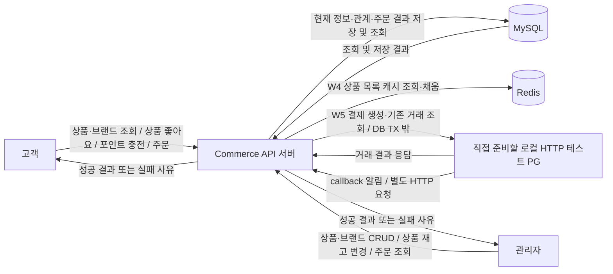
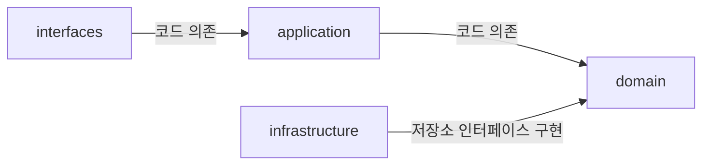
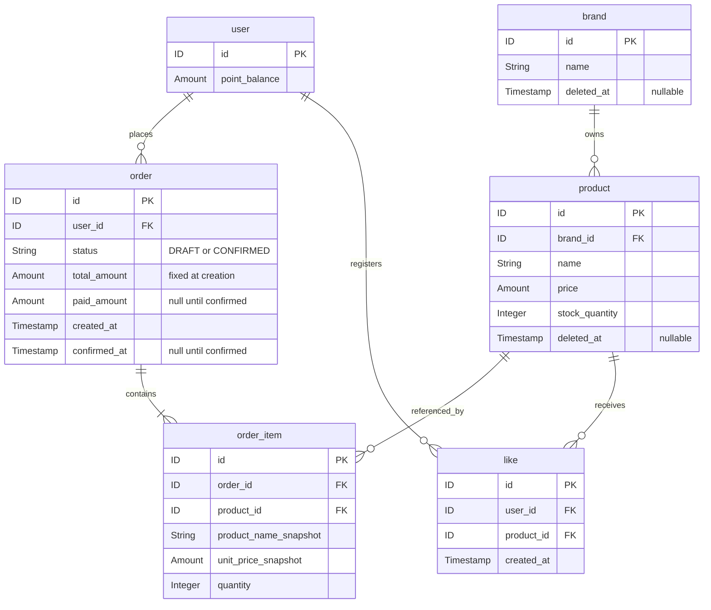
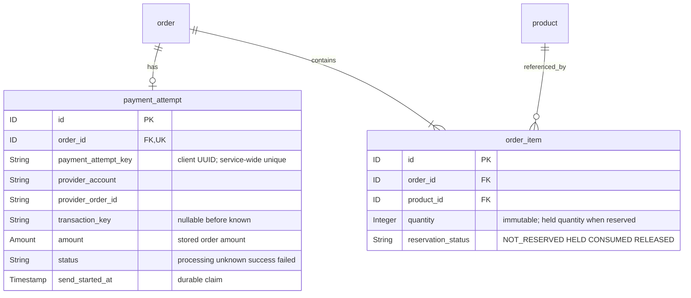
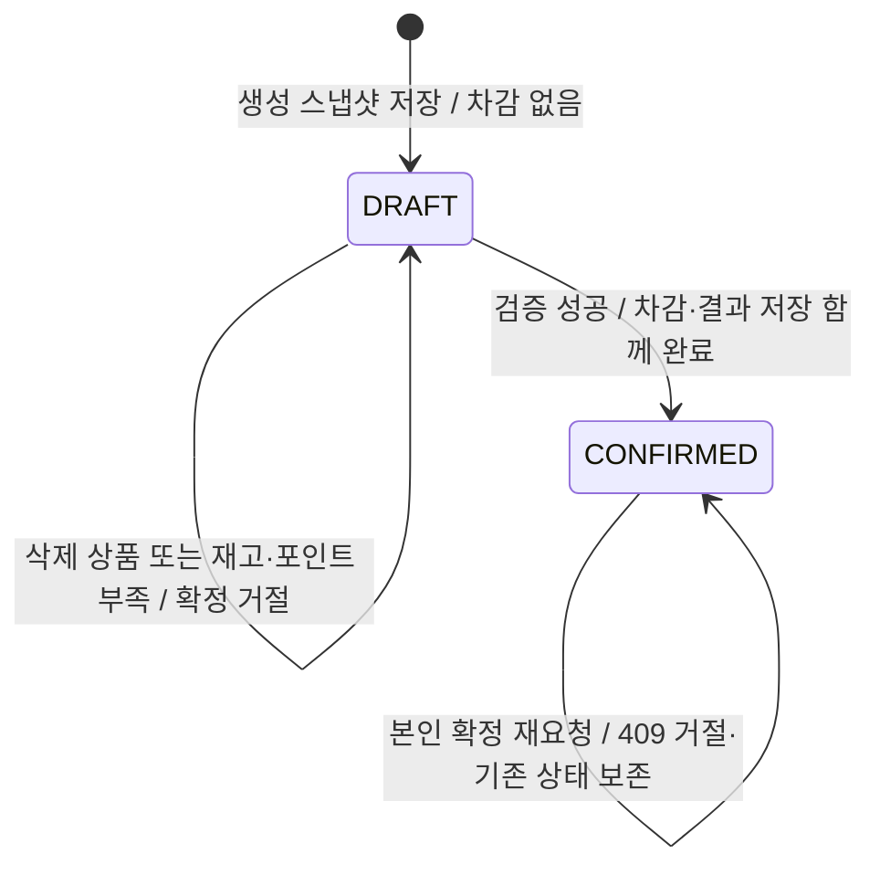

# 커머스 설계 초안

2026-09-17 이벤트 스토밍 대화부터 W5까지 확장하는 전체 설계 문서다. 버드뷰, 구조와 의존, 도메인 관계와 책임, 세 대표 흐름을 함께 다루며 API 계약·정책 선택·TDD 계획은 별도 문서로 연결한다. 현재 구현은 업무 테이블 6개와 W4의 `product_list_revision`을 사용한다. W5는 아래 **선택한 설계와 남은 제안을 구분한다. 2026-10-23 예약 상태의 순수 enum만 첫 구현·검증했고, OrderItem 영속화·PaymentAttempt·PG 연동·DDL은 아직 적용하지 않았다.** [첫 TDD 실행 기록](../week5/order-reservation-state-tdd-log.md)을 현재 구현 범위의 근거로 삼는다.

**2026-10-20 W5 1단계:** [과제 원문](../week5/assignment-original.md)을 기준으로 미확정 주문의 결제를 PG로 교체하는 설계를 작성했다. 원문의 필수 동작, 사용자 선택, 기술 제안·미정을 구분한다. 현재 코드는 여전히 POINT 방식이다. 아래 W2~W4 구현·측정 기록은 당시 증거이며 W5 완료 증거가 아니다. 기존 POINT 확정 기록은 보존하되 새 PG 시도의 계약은 [W5 설계](#w5-pg-결제-설계)를 우선한다.

**2026-10-22 설계 갱신:** 사용자가 최초 요청의 제한 조회·timeout·회로 초기값과 저장 구조 A를 선택했다. PaymentAttempt는 별도 기록, 예약은 기존 OrderItem의 불변 수량과 새 예약 상태로 관리하며 별도 StockReservation은 만들지 않는 설계다. 이 설계 갱신 시점에는 코드·DDL·테스트를 구현/실행하지 않았으며, 이후 첫 예약 상태 증분은 위 실행 기록에서 구분한다. 상세 수치·이유와 미채택 대안은 [정책 문서](commerce-policy-decisions.md#w5-최초-결제-요청의-대기조회회로-설정)에 둔다.

**동일 일자 후속 선택:** 호출자가 생성한 UUID 시도 키를 서비스 전역에서 유일하게 보호한다. 카드 입력은 테스트 PG 규격을 따르되 예시 번호 한 종류로 제한하지 않는다. 최초 발송은 PG 호출 전 DB 상태 전이를 원자적으로 성공시키고 커밋한 실행만 수행한다. 선택 범위와 남은 요청 비교·필드·TX 배치는 [정책 결정](commerce-policy-decisions.md#카드-입력과-최초-발송의-선택)에서 구분한다.

W2 구현은 고객 12개·관리자 13개의 **25개 API를 JPA/MySQL까지 연결**한다. 당시 기능별 HTTP·도메인·저장·동시성 검사와 운영 스키마의 증거는 [완료 체크리스트](commerce-completion-checklist.md)에 보존한다. **2026-10-08 W3 브랜드 일괄 삭제의 정상 처리·기본 경계·전체 롤백·삭제 후 사용 제한·접근 경계·주문 및 상품 등록 경합(W3-BRAND-01~08)을 검증했다.** 마지막 연결·동시성 검증 범위는 [네 번째 증분 기록](../week3/brand-removal-tdd-log.md#네-번째-증분--w3-brand-0408-연결동시성-검증)을 따른다.

W3에서는 **주문 재확정 거절 정책(P16)을 승인**하고 `W3-RECONFIRM-01..06`을 검증했다. W5에서도 이전 POINT 주문의 이 계약은 보존하지만 새 PG 동일 시도의 결과 재반환과 구분한다. 실제 과거 결과는 [재확정 실행 기록](../week3/order-reconfirmation-tdd-log.md)을 따른다. W3의 재고·포인트 경쟁·내부 저장 실패/롤백·갱신 유실 대조군은 해당 재확정 증분과 별도 기록이다.

후속으로 **주문 저장 경계 실패·롤백 `W3-ORDER-TX-01..03`을 검증 완료**했다. 생산 코드·락 변경 없이 신규 4개 사례와 전체 545개 테스트가 통과했다. 최초 확정의 실제 트랜잭션·JDBC 실행 경계는 아래 [호출 경계](#최초-확정의-실제-트랜잭션-진입과-sql-저장-경계), 기대값과 실제 결과는 [TDD 계획](commerce-tdd-plan.md#w3-주문-저장-경계-실패와-롤백의-tdd-계획)·[실행 기록](../week3/order-transaction-tdd-log.md)을 따른다. 재고·포인트 경쟁 수치와 갱신 유실 대조군의 완료를 뜻하지 않는다.

| 실제 구현 | 책임과 검증 기록 |
| --- | --- |
| 브랜드 | BrandName·Brand의 이름/삭제 상태, 관리자 CRUD와 공유 브랜드 잠금. W3에서는 BrandDeletionService가 연결 상품의 일괄 논리 삭제 후 브랜드를 삭제한다. [W3 증분별 기록](../week3/brand-removal-tdd-log.md), [W2 당시 관리자 브랜드 기록](commerce-tdd-admin-brand-http-log.md) |
| 상품 | Product가 ProductStock을 내부 소유하고 이름·가격·삭제 상태를 관리한다. JPA 저장, 관리자 변경, domain 소유 ProductSummary의 집계·정렬·페이지 조회. [상품 기록](commerce-tdd-product-log.md) |
| 사용자·포인트·좋아요 | 단일 fixture 매핑에서 초기 DB 사용자를 준비하고 User가 잔액을 관리한다. 좋아요는 유일 관계·실제 삭제·본인 조회이며 사용자→상품 순서로 잠근다. [포인트·좋아요 기록](commerce-tdd-point-like-log.md) |
| 주문 | OrderQuantities의 합산, Order/OrderItem의 생성 스냅샷·금액·소유권·확정 상태, OrderService의 단일 트랜잭션과 공통 잠금 순서. [주문 기록](commerce-tdd-order-log.md) |
| HTTP 경계 | StrictInput의 형식 검사, AdminBoundaryConfig의 Spring Security·CSRF 검사와 AdminRequester의 역할 변환, CommerceErrors의 업무/프레임워크 오류 변환. 기존 Example 관찰 계약은 유지한다. |
| 저장 경계 | domain 저장소 약속을 infrastructure의 Spring Data JPA·EntityManager 구현이 제공한다. 새 엔티티는 직접 JPA 매핑과 자체 감사 필드를 사용하며 기존 BaseEntity를 개편하지 않는다. |

초기 재고·식별·브랜드·수량의 작은 Red→Green→Refactor 기록은 AGENTS의 문서 목록에 보존한다. 운영 스키마는 기능 구현 후 별도 빈 MySQL에서 수동 SQL을 적용하고 JPA validate로 검사한다. 적용 방법과 완료 범위는 [스키마 안내](commerce-schema-operations.md)를 따른다.

## 문서 안내

[API 계약](commerce-api-contract.md), [TDD 계획](commerce-tdd-plan.md), [정책 선택과 설계 검토](commerce-policy-decisions.md)는 각각의 상세 내용을 관리한다. 버드뷰·계층 의존·도메인 관계·세 대표 흐름은 이 문서에 함께 유지한다.

## W5 PG 결제 설계

### 이번 과제의 테스트 PG는 무엇인가

**이번 과제는 토스페이먼츠 등 업체가 제공하는 테스트 환경에 연결하는 작업이 아니다.** [과제 원문](../week5/assignment-original.md)의 로컬 HTTP 계약을 따르는 작은 테스트 서버를 우리가 준비한다. 여기서 fixture는 성공·실패·지연 등을 반복해서 재현할 수 있는 테스트 장치를 뜻한다. **현재는 설계만 작성했으며 이 서버와 PG adapter는 아직 미구현이다.**

| 구분 | 이번 과제에서의 의미 |
| --- | --- |
| 연결 대상 | 우리가 준비할 로컬 HTTP 서버. 업체 계정·테스트 API 키를 발급받아 업체 서버에 연결하는 방식이 아니다. |
| 통신 방법 | commerce의 실제 PG adapter가 HTTP 요청을 보낸다. 결제 메서드의 반환값만 대체하는 단위 테스트와 구분한다. |
| 준비할 기능 | 과제의 결제 생성·거래 조회·주문별 거래 조회, 거래 상태·호출 횟수 관찰, callback과 응답 지연·유실의 통제. 실제 카드 승인·금전 이동은 하지 않는다. |
| 실행 규모 | 테스트 안에서 작은 HTTP 서버를 띄우고 종료하는 구성도 가능하다. 별도 PG 프로젝트·독립 프로세스·별도 DB·관리 화면을 필수로 만들지 않는다. 구체 도구는 아직 선택하지 않았다. |
| “외부 결과”의 의미 | 같은 컴퓨터나 테스트 프로세스 안에 있어도 PG 거래 상태는 commerce의 DB 트랜잭션과 독립적으로 관리한다. commerce 롤백으로 PG 거래가 사라지면 안 되며, 서비스·클라이언트 재시작 시험 중에는 fixture의 거래 상태를 유지한다. |
| 학습·검증 목표 | 예를 들어 PG 거래는 생성한 뒤 응답만 유실시킨다. 우리 서버가 중복 결제 없이 기존 거래를 조회하고 주문을 마무리하는지 확인한다. PG 제품 자체를 만드는 것이 목표는 아니다. |

나중에 실제 업체를 연동하는 작업은 별도 범위다. 이 과제의 경로·헤더·422 응답·멱등성 조건을 업체 규격으로 간주하거나 URL·키 설정만 바꾸면 호환된다고 가정하지 않는다.

### 변경과 보존

| 구분 | W5 목표 · 과제 확정 | 현재 구현과 영향 |
| --- | --- | --- |
| 미확정 주문 | 기존·신규 DRAFT 모두 PG로 결제를 시작한다. 주문 생성 시점에는 예약하지 않는다. | `OrderService.confirm()`의 포인트 검증·차감과 단일 확정 흐름을 교체해야 한다. |
| 과거 주문·포인트 | 이전 POINT 확정 주문의 수단·금액·품목·결과와 재확정 409를 보존한다. 충전·잔액 API는 독립적으로 유지한다. | 현재 `Order`에는 결제수단 필드가 없다. 기존 확정 행을 POINT로 식별하는 이행·fixture 검증이 필요하다. |
| 외부 결과 | 생성 수락·처리 중·미확인·최종 성공·실패를 구분한다. PG 경로의 포인트 변화는 0이다. | 두 주문 상태만으로는 부족하다. `requireDraft()`가 CONFIRMED만 거절하므로 상태 추가와 함께 허용 전이를 명시해야 한다. |
| 중복·복구 | 주문당 한 시도, 발송과 결과 반영을 각각 보호한다. callback·수동 reconcile은 기존 거래를 확인한다. | 메모리 락만으로 끝내지 않고 DB 기록·제약·잠금으로 연결한다. |
| 재고·캐시 | 요청 전에 예약하고 성공은 소비, 확정 실패만 반환한다. 가용 재고 변경과 DB 목록 버전을 함께 커밋한다. | `ProductStock`에는 반환 행동이 없다. 기존 삭제 검사를 완화하지 않고 예약 반환 책임을 추가해야 한다. |

### 상태와 효과

아래는 **과제가 정한 의미**다. 예약 상태 이름은 2026-10-23 순수 `OrderItemReservationStatus` enum으로 구현·검증했지만 주문·결제 상태와 필드·영속화는 여전히 구현 전 설계다. 주문의 상태와 결제 시도의 상태를 같은 필드로 혼동하지 않는다. 예시는 다른 재고 변경 없이 초기 가용 재고 5개에서 2개를 예약하는 경우다.

| 상황 | 주문 / 결제 시도 | 가용 재고 / 예약 | 다음 행동·금지 |
| --- | --- | --- | --- |
| 생성 또는 TX A 사전 검사 실패 | DRAFT / 시도 없음 | 5 / 없음 | 부족·삭제·입력 오류는 PG 호출 0. TX A 전체 롤백 뒤 조건이 개선된 DRAFT는 다시 요청할 수 있다. |
| TX A 커밋, PG 최종 결과 없음 | PAYMENT_PENDING / 미완료 | 3 / HELD 2 | 시도·예약을 영속 기록한다. 최초 POST 전에는 발송 시작 전이·커밋도 필요하며 TX A에 함께 두는 배치는 제안이다. 로컬 준비 상태를 PG가 접수했다는 증거로 사용하지 않는다. |
| 검증된 생성 수락 PENDING | PAYMENT_PENDING / PENDING | 3 / HELD 2 | 확정하지 않는다. 응답 대기 방식은 W5-Q02 선택을 따른다. |
| timeout·응답 유실·조회 불가 | PAYMENT_PENDING / UNKNOWN | 3 / HELD 2 | 기존 거래를 확인한다. 새 POST·시간 경과만으로 반환 금지. |
| 검증된 SUCCESS | CONFIRMED / SUCCESS | 3 / CONSUMED 2 | 저장 주문 금액으로 확정한다. 재고·포인트 추가 차감 없음. |
| 검증된 FAILED·효과 0건 확정 거절 | PAYMENT_FAILED / FAILED | 5 / RELEASED 2 | 한 번 반환. 이후 새 키로 새 결제를 시작하지 않는다. |
| 조회 0건·복수 거래·식별/금액 불일치 | 미완료 상태·미확인/충돌 보존 | 3 / HELD 2 | 임의 성공·실패·반환 금지. 이미 종결했다면 기존 종결 상태를 보존한다. |
| 종결 뒤 중복 결과·늦은 PENDING/timeout | 기존 종결 상태 | 기존 소비·반환 상태 | 같은 결과는 추가 효과 없음. 상충 결과는 기록하고 기존 결과를 덮어쓰지 않는다. |

효과 0건 거절은 고정 테스트 PG 생성 응답의 **422 + `TEST_PG_REJECTED_BEFORE_CREATE` + JSON boolean `transactionCreated=false` + 주문·금액 일치**와 거래가 나중에도 생기지 않는 fixture 계약을 모두 만족해야 한다. 일반 4xx·5xx·조회 404·빈 배열은 이 증거가 아니다. 상세 외부 형식은 [W5 API 계약](commerce-api-contract.md#w5-pg-결제-api-설계)을 따른다.

### 로컬 트랜잭션과 발송 경계 제안

과제는 짧은 TX A / TX 밖 HTTP / 짧은 TX B를 요구한다. **사용자가 선택한 발송 규칙은 PG 호출 전에 DB 상태 전이를 성공시키고 커밋한 실행만 최초 POST하는 것**이다. 아래의 별도 조율 객체·트랜잭션 담당 객체와 TX A에 발송 시작 기록을 함께 넣는 구체 배치는 여전히 기술 제안이며 코드에 구현하지 않았다.

| 구간·책임 | 처리 순서 | 커밋·실패·잠금 경계 |
| --- | --- | --- |
| 조율 application | 최초 진입 시점의 전체 예산 설정 → 요청 검증·사용자 식별 → TX A → 발송 권한을 얻은 신규 실행의 PG 호출 → 필요한 제한 조회와 TX B | HTTP·조회 사이 대기를 포함하는 바깥 트랜잭션을 만들지 않는다. 기존 클래스 단위 `@Transactional` 안에 PG를 끼워 넣지 않는다. |
| TX A · 결제 준비, 발송 기록 동시 배치 제안 | 주문 잠금·소유권 → POINT/기존 PG 시도 분기 → 신규 DRAFT의 저장 수량·상품/브랜드·재고 검사 → 가용 재고 차감·예약·시도·발송 시작 전이 → 목록 버전 증가 | 동일 트랜잭션으로 커밋한다. 실패하면 전부 롤백하고 PG 0회. 발송 시작 전이를 원자적으로 성공시키고 커밋한 실행만 POST한다. 이미 시작된 상태를 읽은 다른 실행은 저장 상태만 반환한다. |
| 외부 HTTP · PG 포트/adapter | DB에 저장한 제공자 계정·providerOrderId·금액으로 생성 또는 기존 거래 조회 | 활성 DB 트랜잭션·업무 잠금 없음. PG로 카드 입력을 보내는 것은 최초 발송 권한을 얻은 실행뿐이며 DB·로그에 번호를 남기지 않는다. confirm 재요청의 내부 비교 사용은 [W5-D10 제안](commerce-policy-decisions.md#w5-hmac-요청-지문-제안)으로 구분한다. 생성 자동 재시도와 숨은 재시도 금지. |
| TX B · 공통 결과 적용 | 주문 잠금 → 현재 시도·외부 식별·금액·종결 상태 재검증 → 예약 소비 또는 반환 → 주문·시도 결과 저장 → 재고가 바뀌면 목록 버전 증가 | callback·reconcile·생성 응답이 같은 적용 경계를 사용한다. 모두 커밋/롤백하며 외부 거래는 내부 롤백으로 취소되지 않는다. 완료 응답은 커밋 성공 후에만 구성한다. |
| 복구 | 저장한 식별자로 PG 조회 → 같은 TX B 재진입 | 추가 create 없음. 외부 성공 후 DB 저장 실패도 기존 거래 재조회로 반영한다. 실패 반환 TX의 롤백 뒤에는 아직 반환되지 않은 예약을 다시 적용할 수 있다. |

로컬의 `미시작 → 발송 시작`은 의미 설명용 상태 전이다. 이 전이·커밋에 성공한 **그 실행**만 보내며, 단순히 발송 시작 상태를 조회한 실행에는 허용하지 않는다. PG 호출 후 status를 저장하는 방식만으로는 동시 POST를 막을 수 없다. 로컬 발송 상태는 PG의 PENDING 관찰과 구분하고, 이후 UNKNOWN 등으로 변경되어도 시작 이력을 잃지 않게 저장한다. rollback되거나 커밋을 확인하지 못한 실행은 보내지 않는다. 별도 발송 권한 클래스·테이블을 필수로 추가하지 않으며 PaymentAttempt의 상태·기록으로 표현할 수 있다. 정확한 필드·enum과 잠금/조건부 전이의 배치는 후속 상세 설계다.

발송 시작 기록 커밋 직후 실제 HTTP 전에 프로세스가 종료되면 **외부 거래가 0건인데 예약이 유지되는 미완료**가 남을 수 있다. 재시작·조회 0건을 재발송 근거로 삼지 않는다. 중복 효과 방지와 모든 시도의 자동 완료는 다른 보장이다. 이 한계를 자동 만료·예약 반환·새 결제로 숨기지 않는다.

조율 경계는 외부 트랜잭션 참여도 막거나 명시적으로 거절하도록 설계해야 한다. 별도 Spring 프록시 빈 또는 명시적 트랜잭션 경계로 TX A/B의 실제 종료를 확인하며, 같은 객체 내부 호출에 annotation만 붙이는 방식으로 분리를 주장하지 않는다. 구체 기술 선택은 [정책 제안](commerce-policy-decisions.md#w5-결제-교체의-선택과-질문)에서 관리한다.

### 최초 요청의 제한 조회와 회로 보호

**사용자가 선택한 초기 설계이며 미구현·미검증**이다. 최초 요청에서 PENDING/timeout을 관찰하면 바로 포기하지 않고 기존 거래를 한정해서 조회한다. 설정 수치·선택 이유·다른 대안의 단일 기준은 [W5 대기·조회·회로 설정](commerce-policy-decisions.md#w5-최초-결제-요청의-대기조회회로-설정), 경계값과 실제 HTTP 검증은 [TDD 계획](commerce-tdd-plan.md#w5-pg-결제-tdd-계획)을 따른다.

| 경계 | 선택한 설계·지켜야 할 것 |
| --- | --- |
| 전체 예산 | 최초 요청 진입부터 180초 목표. 외부 확인은 같은 시점부터 175초까지, 최종 처리에 5초 여유. TX A·생성·조회·대기를 포함하고 timeout마다 재시작하지 않음 |
| 개별 HTTP | 연결 3초·풀 대기 1초, 생성 응답 60초/총 65초, 조회 응답 5초/총 10초. 실제 HTTP 종료·DB 대기·인바운드 제한 검증 전에는 전체 하드 상한을 주장하지 않음 |
| 추가 조회 | 생성은 최대 1회. 첫 조회는 예산/회로가 허용하면 즉시, 이후 완료 후 5→10→15초에 ±20% 분산. 최초 실행의 조회 시도 최대 12회에 연결 실패도 포함. 남은 호출/최종 처리 예산이 부족하면 새 호출하지 않음 |
| 조회 회로 | 같은 인스턴스의 PG/제공자 계정 공통 조회 경계에서 최근 20건·최소 10건, 장애 또는 3초 초과 지연 비율 50%, OPEN 30초, HALF_OPEN 2건·최대 40초. 회로 OPEN에서는 외부 조회 0회 |
| 결과와 중단 | 종결 확인 즉시 반환. 횟수·예산 소진 뒤 미완료면 202·상태·조회 경로. OPEN 중에도 남은 전체 예산 안에서만 기다리고 탐색하며, 시간 경과만으로 실패/예약 반환하지 않음 |
| 경합·범위 | 조회 전/종료 전 저장된 종결 결과를 확인해 callback 선종결 보존. 다른 동일 confirm은 저장 상태를 반환하고 긴 루프/생성을 중복 시작하지 않음. callback·별도 reconcile의 총 예산까지 180초로 선택한 것은 아님 |

DB TX·재고 잠금은 HTTP와 조회 사이 대기 동안 보유하지 않는다. 예산을 소진하거나 연결을 종료해도 외부 결제가 취소되지 않는다. 이후에도 callback·수동 reconcile로 같은 거래를 마무리할 수 있으며, 이미 종결된 결과는 늦은 timeout으로 퇴행하지 않는다.

### 잠금·삭제·관리자·캐시 연결

기존 READ_COMMITTED, 비관적 잠금, 필요한 기존 행의 **주문 → 사용자 → 브랜드 ID 오름차순 → 상품 ID 오름차순 → 목록 버전 마지막** 상대 순서와 3초 DB 락 대기 제한은 유지한다. PG 호출에 사용자 포인트 차감·잔액 부족 검사를 남기지 않는다.

| 경로 | 보호 방법 제안·유지할 결과 |
| --- | --- |
| 시도·예약 변경 | 먼저 해당 주문 행을 잠그는 공통 진입을 제안한다. 상품별 예약·소비·반환과 관리자 예약 합계 검사는 같은 상품 행 보호 아래 수행한다. 시도·예약 상태를 담는 품목의 명시적 잠금은 주문·브랜드·상품 뒤에 배치하고 역순 경로를 만들지 않는다. DB 유일 제약·FK의 실제 잠금도 후속 테스트로 확인한다. |
| 예약 전 상품 삭제 | TX A가 기존 브랜드→상품 잠금을 얻은 뒤 현재 삭제 상태를 재검사한다. 삭제가 먼저 커밋됐다면 시도·예약·PG 호출 없이 거절한다. |
| 예약 후 상품 삭제 | 기존 soft delete·FK 보존을 유지한다. TX B는 삭제 행을 포함해 잠그고 저장된 예약을 마무리한다. 현재 `lockProducts()`의 미삭제 필터나 `Product.requireActive()`를 그대로 재사용해 결과 처리를 막지 않는다. 반환으로 `deleted_at`을 지우지 않는다. |
| 관리자 재고 설정 | 가용 수량을 최종 설정하며 예약을 지우지 않는다. **사용자 승인 W5-Q03:** `설정할 가용 수량 + 모든 HELD 예약 합 ≤ Integer.MAX_VALUE`여야 한다. 상품 잠금 후 넓은 중간 계산·범위 검사로 검증하고, 초과하면 변경 없이 거절한다. 구체 오류 응답은 미정이다. |
| 캐시 버전 | 예약 차감 TX A와 반환 TX B에서 업무 flush→revision 증가→함께 커밋한다. 성공의 예약 소비에는 재고 추가 차감이 없으므로 그것만으로 버전을 늘리지 않는다. Redis 호출은 DB 쓰기 TX에 넣지 않고 기존 TTL·키·삭제 신선도 정책을 유지한다. |

예를 들어 가용 3·예약 2에서 관리자가 가용 수량을 10으로 설정했다면 예약은 2로 유지한다. 이후 확정 실패면 가용 수량은 **12**다. 예약 당시의 가용 수량 5로 되돌리는 동작이 아니다. 성공이면 10을 유지한다.

### 변경 책임·파일과 검증 연결

| 책임·기존 파일 | 예정 변경 | 검증 기준 |
| --- | --- | --- |
| `application/order/OrderService`, `domain/order/Order`·`OrderStatus` | POINT 확정과 PG 시작 분리, 명시적 상태 전이, 비TX 조율·TX A/B 책임 분리 | 상태·원자성·동시 발송·외부 대기 중 TX 미보유 |
| `PaymentAttempt` 별도 기록·기존 `OrderItem` 예약 상태, PG 포트/adapter (미구현) | 선택한 A안의 시도당 발송 권한·외부 식별·불변 수량/예약 상태, 실제 HTTP와 DB 제약 | 재시작·키 충돌·세 HTTP 계약·미예약/소비/반환·중복 결과 |
| `Product`·`ProductStock`, `AdminProductService`, 재고 저장소 | 예약 반환 행동, 삭제 보존, Q03의 전체 미소비 예약 합 검사 | 예약/관리자 변경/반환 경합, 상한·삭제 경계 |
| `OrderV1Controller`, `OrderInfo`·`AdminOrderInfo`, callback·reconcile 경계 | 대기·미확인·종결 응답과 고객/관리자 조회 연결 | 실제 HTTP·소유권·callback 검증. 구체 필드·오류는 API 문서의 상태를 따른다. |
| 수동 DDL·JPA 매핑·기존 스키마 테스트 | 기존 POINT 식별 이행과 새 상태·유일 제약·FK | 기존 행 보존·새 빈 DB·JPA validate를 별도 확인. 사용자 DB 초기화 금지 |
| `ProductListRevisionRepository` 연결과 W4 캐시 테스트 | 예약·반환의 버전 참여, 실패 시 함께 롤백 | 변경 후 새 조회·기존 진행 중 snapshot 허용 회귀 |

현재는 설계와 기대값만 작성했다. 테스트 코드는 추가·수정·실행하지 않았다. 실행 순서·필수 실패 장면과 기존 테스트의 계약 전환은 [W5 TDD 계획](commerce-tdd-plan.md#w5-pg-결제-tdd-계획)을 따른다. 최초 요청의 시간/회로 초기값과 저장 A안은 선택됐으며, 남은 입력·ACK·실제 도구 연결·다른 진입점 총 예산과 데이터 보존 확인은 [W5 질문](commerce-policy-decisions.md#w5-결제-교체의-선택과-질문)에 구분한다.

## W4 상품 조회 개선의 첫 증분

아래 첫 증분과 후속 1·2단계는 당시 선택·측정 기록이다. 현재는 SQL 개선, [Redis + DB 버전 캐시](#w4-전체-좋아요순-캐시-설계), 요청 합치기와 좁은 좋아요 순위 집계를 구현했고 [TTL·메모리 비교](../week4/product-list-cache-ttl-memory.md)까지 완료했다. 단계별 과거 수치는 보존하며 [현재 상태·최신 검사](commerce-completion-checklist.md#최신-통합-검사)와 구분한다.

[W4 과제](../week4/assignment-original.md)의 첫 증분은 기존 상품 조회를 변경하지 않고 개선 전 기준선을 확보하는 것이다. 실제 `GET /api/v1/products?brandId=1007&sort=price_asc&page=0&size=20` 요청을 격리된 MySQL의 상품 10,000개 데이터로 측정한다. 기존 Controller → ProductQueryService → ProductQueryRepositoryImpl → MySQL 경로를 사용하며 업무 모델·계층 의존·세 대표 흐름은 유지한다.

- 기존 응답 필드, 브랜드 필터, 세 정렬과 ID 내림차순 동점 기준, 페이지·전체 개수, 삭제 비노출을 유지한다.
- 수동 DDL의 실제 인덱스와 seed를 고정하고, 요청 SQL·바인딩·실행 계획·반복 HTTP 지연·응답을 기록한다. SQL 수만으로 성능을 판단하지 않는다.
- 기준선 작성 당시에는 운영 쿼리·인덱스·트랜잭션·락을 변경하지 않고 캐시도 추가하지 않았다. 이후 측정 결과를 바탕으로 아래 개선을 진행했다.
- 기준선 작성 당시 캐시 대상(목록 또는 상세), payload·키·TTL, 표시 신선도와 실패·복구 정책은 미정이었다. 후속 사용자 답변과 남은 제안은 [W4 캐시 설계](#w4-전체-좋아요순-캐시-설계)를 따른다. 기존 비노출·소유권·DB 기반 주문 판단은 완화하지 않는다.

측정 구성·실행 방법·결과는 [상품 조회 기준선 기록](../week4/product-query-baseline.md), 테스트 기대값은 [W4 기준선 TDD 계획](commerce-tdd-plan.md#w4-상품-조회-기준선-tdd)을 따른다. 이후 구현한 Redis·캐시 책임은 아래 W4 캐시 설계의 버드뷰·계층·대표 흐름에 구분해 기록한다.

### 후속 1단계: SQL·인덱스 개선 완료

2026-10-15에는 회귀 테스트를 먼저 보강한 뒤 고객 `latest`·`price_asc` 목록의 전체 좋아요 join/group을 projection의 상관 count로 바꾸었다. 브랜드·상품 노출 조건과 정렬·페이지·응답은 유지하며, `likes_desc`·관리자·내 좋아요·상세는 기존 경로를 유지한다. Controller·application·domain의 책임과 세 대표 흐름은 변하지 않는다.

브랜드·가격순 복합 인덱스는 기존 DDL을 교체하지 않고 [007 추가 SQL](../../apps/commerce-api/src/main/resources/db/schema/007-product-brand-price-index.sql)로 제공한다. 같은 10,000개 seed의 고정 브랜드·가격순 첫 페이지에서 목록 상품 읽기 99→20행, 좋아요 lookup 99→20 loops, 임시 집계·별도 정렬 제거를 확인했다. 전체 개수 쿼리는 유지해 요청 SQL 수는 2회 그대로다. 인덱스만 추가했을 때는 기존 계획을 개선하지 못했다.

기존 읽기 트랜잭션과 변경 경로의 READ_COMMITTED·비관적 잠금은 유지했다. 이 증분 당시에는 Redis·로컬 캐시를 추가하지 않았다. 당시 최종 전체 **559개 테스트·Checkstyle·ArchUnit 통과**, 정확한 전후 증거·TDD 과정·인덱스 쓰기 비용·측정 한계는 [개선 기록](../week4/product-query-optimization.md)에서 관리한다.

후속 [목록·상세 실측 비교](../week4/product-read-cost-comparison.md)에서는 전체 좋아요순 첫 페이지를 첫 Redis 실험 후보로 추천했다. 당시에는 미채택 제안이었고, 이후 승인·구현한 범위는 [현재 캐시 설계](#w4-전체-좋아요순-캐시-설계)를 따른다. 전체 최신순·가격순에서는 좋아요 상관 조회가 9,812 loops 발생하여 추가 SQL 개선 여지도 확인했다. 앞선 브랜드·가격순의 20 loops를 모든 목록 조건으로 일반화하지 않는다. 해당 비교 증분은 측정 테스트·문서만 변경했으며 관련 58개 테스트·Checkstyle·ArchUnit을 통과했다.

### 후속 2단계: 무필터 최신순·가격순의 페이지 한정 좋아요 집계

2026-10-15에는 고객 무필터 `latest`·`price_asc`만 `전체 개수 → 좋아요 없는 상품·브랜드 페이지 → 선택 ID의 좋아요 일괄 집계`로 변경했다. 저장소 내부 `ProductPageRow`로 페이지 순서를 보존하고 좋아요 관계가 없으면 0으로 합성한다. 브랜드 필터·좋아요순·상세·관리자·본인 좋아요와 API·업무 모델·계층 의존·세 대표 흐름은 유지한다.

기존 읽기 트랜잭션의 실제 RR·동일 연결에서 세 조회가 같은 스냅샷을 읽는지 중간 쓰기 커밋을 끼워 검증했다. `readOnly`만으로 일관성이 보장되는 것은 아니므로 읽기 격리 변경 시 재검토한다. 쓰기 트랜잭션·락과 인덱스는 변경하지 않았고 Redis·로컬 캐시는 추가하지 않았다.

같은 10,000개 seed의 첫 페이지에서 SELECT는 2→3회지만 좋아요 계산 범위를 전체 9,812개 후보에서 선택 ID 20개로 제한했다. HTTP p50은 약 21~22ms→11ms로 줄었다. 전체 개수·상품 후보 읽기와 정렬 비용은 여전히 남는다. TDD·실제 전후 증거·검증 범위·측정 한계는 [무필터 목록 개선 기록](../week4/global-list-query-optimization.md)을 따른다.

## W4 전체 좋아요순 캐시 설계

2026-10-16 사용자가 **Redis + DB 버전 방식의 TDD 구현**을 승인하여 아래 경로를 구현했다. 삭제 전 버전을 확인한 진행 중 hit도 이전 결과를 허용한다는 후속 답변을 반영했다. 이후 실측과 사용자 승인으로 **이번 과제에서는 TTL 60초 유지·서버 시작 워밍 미도입**을 확정했다. 기존 요청 시 채움을 유지하며 연결/명령 제한 100ms도 변경하지 않는다. 현재 선택이 운영 최적값이나 SLO의 증명은 아니다. 최초 구현 증거는 [캐시 TDD 실행 기록](../week4/product-list-cache-tdd-log.md), 이후 완료한 [TTL·메모리 비교](../week4/product-list-cache-ttl-memory.md)와 최신 검사 범위는 [완료 체크리스트](commerce-completion-checklist.md#최신-통합-검사)를 따른다. 실제 홈 호출·운영 최적성은 별도 검증 사항이다.

| 구분 | 이번 설계의 범위와 이유 |
| --- | --- |
| 과제의 확정 대상 | `GET /api/v1/products?sort=likes_desc&page=0&size=20`, 브랜드 필터 없음. 사용자는 홈·메인 진입에서 반복해서 보는 첫 페이지를 우선하자는 방향을 선택했고 이번 과제에서는 이미 구현·검증한 이 범위를 유지한다. 실제 홈 호출 조건·접근 빈도는 별도 확인 사항이다. |
| 비용 근거 | 기존 [목록·상세 비교](../week4/product-read-cost-comparison.md)의 10,000개 seed에서 전체 좋아요순 첫 페이지 p50은 두 라운드 약 50.654/49.639ms였다. 전체 집계·정렬 비용을 재사용할 후보라는 근거이지, Redis 도입 효과나 운영 트래픽의 증거는 아니다. |
| 기존 계약 유지 | 전체 후보의 `likeCount DESC, product.id DESC` 정렬 후 페이지 선택. 좋아요가 모두 0이어도 같은 규칙이다. 정렬 생략 시 `latest`를 유지하며 캐시 때문에 자동 전환하지 않는다. 필드·삭제 제외·페이지·오류 계약도 유지한다. |
| 비대상 | 다른 페이지·크기, 브랜드 필터, 최신순·가격순, 상세·관리자·내 좋아요는 캐시를 우회하여 DB에서 조회한다. 무필터 좋아요순은 아래 후속 좁은 순위 집계를 다른 page/size에도 사용한다. 첫 페이지 캐시는 다른 페이지 제공을 없애는 뜻이 아니며, 캐시 확대는 별도 측정 후 결정한다. |
| 신선도 경계 | 삭제 전 DB 버전을 확인한 진행 중 hit와 원본 스냅샷을 읽은 진행 중 miss는 이전 결과를 반환할 수 있다. 삭제 완료 후 새로 시작한 조회에서는 새 DB 버전을 사용하여 삭제 대상을 제외한다. |

### 버드뷰와 책임 배치

```text
고객 ─조회→ API 서버 ─현재 버전 확인──────→ MySQL
                  ├해당 버전 캐시 조회/채움→ Redis
                  └miss/장애 시 원본 조회→ MySQL
관리자·고객 ─변경→ API 서버 ─단일 트랜잭션→ MySQL [업무 변경 + 목록 버전 증가]
```

위 화살표는 요청·데이터 접근 방향이지 코드 의존 방향이 아니다. **DB 버전 기반 cache-aside(B)**를 사용한다. hit에도 DB 버전 SELECT 1회가 남는다. miss는 별도 RR 읽기 트랜잭션에서 버전·개수·순위·선정 상세를 함께 읽고 종료한 뒤, 그 버전 키에 저장한다. Redis 대기 중 DB 트랜잭션을 잡아두지 않는다. GET 장애는 DB로 우회하고 SET은 재시도하지 않는다. 외부 트랜잭션에서 호출된 조회는 캐시를 우회하여 미커밋 결과 게시를 막는다.

| 계층·관계 | 구현한 책임 |
| --- | --- |
| interfaces | 기존 입력 검증·응답 변환. 캐시 전에도 잘못된 필터·페이지·정렬은 기존 오류로 거절한다. Redis를 직접 호출하지 않는다. |
| application | `ProductQueryService`가 대상·hit/miss·우회를 조율하고 `ProductListReader`가 실제 DB 프록시 트랜잭션을 담당한다. 후속 `ProductListSingleFlight`는 같은 초기 DB 버전의 진행 중 결과만 JVM 안에서 공유하며 완료 결과는 보관하지 않는다. |
| domain | `ProductListCache`, `ProductListRevisionRepository` 포트와 공개 값만 담는 `ProductListSnapshot`. Redis 타입을 노출하지 않는다. 기존 업무 모델·규칙은 유지한다. |
| infrastructure | domain 포트의 JPA·Redis 구현, JSON 직렬화·TTL·연결 오류 처리. application은 이 구현이 아닌 포트를 사용한다. 기존 ArchUnit 의존 제한을 유지한다. |
| 도메인 관계 | `Brand–Product`, `User–Like–Product`, `Order–OrderItem`과 재고·포인트 책임은 그대로다. 캐시는 공통 조회의 복사본이며 주문의 가격·재고·포인트 판단에 사용하지 않는다. |
| B의 추가 저장 | 기존 6개 업무 테이블과 별개인 `product_list_revision(id=1, revision)` 메타데이터 테이블을 추가했다. 수동 DDL `008`로 초기화한다. Redis 자체를 업무 원본으로 바꾸지 않는다. |

후속 요청 합치기는 최초 miss 뒤 리더의 Redis 재확인 → 실제 snapshot/SET → 결과 공유 순서다. 대기자는 최대 500ms 후 기존 DB 목록 조회로 우회하고 SET하지 않는다. 이전 버전과 새 버전은 별도 그룹이다. 이 대기 중 DB 연결·트랜잭션·업무 잠금을 보유하지 않으며 아래 쓰기 흐름과 잠금 순서는 변경하지 않는다. 세부 선택·한계·실측은 [요청 합치기 기록](../week4/product-list-single-flight-tdd-log.md)을 따른다.

### 후속: 첫 miss의 좋아요 순위 집계와 상세 조회 분리

2026-10-16 사용자가 첫 miss의 DB 비용을 줄이기 위해 **고객 무필터 `likes_desc`의 좁은 순위 집계**를 승인했다. `ProductQueryRepositoryImpl`에서 `전체 개수 → 전체 노출 후보의 상품 ID·좋아요 수 집계 및 순위 페이지 → 선정 ID 상세 IN 조회 → 순위대로 합성`한다. 기본 페이지 크기는 20이며 다른 page/size도 같은 경로를 사용한다. 브랜드 필터·다른 정렬·상세·관리자·본인 좋아요의 조회 구현은 변경하지 않는다.

전체 노출 후보의 `likeCount DESC, product.id DESC` 순위를 구한 뒤 페이지를 선택한다. 임의의 상품 20개를 먼저 고른 뒤 좋아요를 계산하지 않는다. 상품·브랜드 미삭제 조건, 좋아요 0개·품절 상품 포함, 페이지·전체 개수와 응답 필드를 유지한다. 상세 IN의 반환 순서에 기대지 않고 앞서 구한 순서와 좋아요 수를 재사용한다.

| 경계 | 유지·변경 사항 |
| --- | --- |
| 책임·의존 | 저장소 구현 내부의 조회 조합만 변경한다. 기존 `ProductPageRow`로 상세를 받고 domain의 `ProductSummary`로 반환하며 HTTP·application·domain의 의존과 업무 모델은 유지한다. |
| 읽기 트랜잭션 | 기존 읽기 경계를 유지하며 캐시 snapshot은 버전·count·순위·상세를 동일 RR 트랜잭션/연결에서 읽는다. 순위 조회 직후 별도 변경이 커밋돼도 진행 중 응답은 이전 snapshot, 다음 조회는 변경 결과를 반환한다. 읽기 비관적 락은 추가하지 않는다. |
| 캐시·쓰기 | Redis 전체 페이지 payload·키·TTL 60초, DB 버전과 요청 합치기·500ms 대기, local OFF를 유지한다. 업무 쓰기 트랜잭션·잠금 순서도 그대로다. 순위 ID만 Redis에 저장하는 대안 C를 채택한 것이 아니다. |
| SQL 비용 | 비어 있지 않은 DB-only는 count·rank·detail의 3 SELECT, 실제 계산하는 캐시 miss는 초기 버전 1회와 snapshot 4회의 총 5 SELECT, hit는 버전 1회다. 공유 결과를 받는 대기자는 별도 집계를 하지 않으며 빈 페이지는 불필요한 rank/detail을 생략한다. |

추가 상세 왕복까지 포함해 실제 전후 비용을 비교한다. TDD `RANK-01..05`, 성능·회귀 검사와 한계는 [좋아요 순위 집계 실행 기록](../week4/product-like-ranking-tdd-log.md), 선택 이유와 미채택 대안은 [W4-CACHE-D10](commerce-policy-decisions.md#범위와-기본-선택)을 따른다. 앞선 증분의 당시 측정·검사 수치는 과거 기록으로 유지한다.

### 세 대표 흐름과 변경 영향

| 대표 흐름 | 원본 처리·결과 | 캐시에 추가할 책임과 영향 경로 |
| --- | --- | --- |
| 관리자 변경 → 고객 조회 | 기존 권한·입력 검증 후 상품·브랜드를 변경하고 커밋. 실패하면 롤백. 고객은 변경 완료 뒤 새 조회에서 올바른 결과를 받는다. | `AdminProductService`의 생성·수정·재고 설정·삭제, `AdminBrandService`의 이름 변경·일괄 삭제. 표시 필드뿐 아니라 전체 개수·페이지 구성도 영향을 받는다. |
| 좋아요 등록·취소 | 기존 사용자·상품 잠금과 중복/없는 관계의 추가 변경 없는 성공을 유지한다. | `LikeService.register/cancel`의 실제 관계 변경은 좋아요 수와 전체 순위에 영향을 준다. 현재 첫 페이지 밖 상품도 다음 조회의 첫 페이지로 들어올 수 있다. |
| 주문 결제 | W4 구현에서는 포인트·재고·주문을 함께 변경한다. W5 설계에서는 포인트를 분리하고 TX A 예약, 외부 호출, TX B 결과 반영으로 교체한다. | 충전·DRAFT 생성은 버전 불변. W4 확정 차감의 버전 참여를 W5 예약·반환으로 옮긴다. 성공 소비는 추가 차감하지 않는다. 주문 판단에 캐시를 사용하지 않는다. |

상품 `save` 호출만 감지하는 방식은 주문 확정의 변경 감지 저장과 브랜드 삭제의 bulk UPDATE를 빠뜨릴 수 있다. 상품의 `updatedAt`만으로 브랜드 이름·좋아요 변경까지 대표할 수도 없다. payload를 줄이는 대안을 선택하면 영향 목록도 함께 다시 검토한다.

위 9개 변경 경로에서 기존 업무 잠금과 READ_COMMITTED를 유지하고 **업무 flush → 목록 버전 원자적 증가 → 함께 commit**한다. Redis DEL/SET을 쓰기 트랜잭션에 넣지 않는다. 버전 증가 실패도 업무 변경과 함께 rollback한다. 동일 값 수정·중복 좋아요·없는 좋아요 취소·재삭제는 불필요하게 증가시키지 않는다. 버전 행은 마지막에 갱신하므로 서로 다른 상품의 쓰기도 이 행에서 경합할 수 있다. 여러 변경 서비스를 하나의 외부 트랜잭션으로 임의 조합하는 흐름은 현재 HTTP 유스케이스가 아니며 별도 잠금 순서 검토가 필요하다.

선택 이유·TTL 비교·대안과 미정 질문은 [정책 검토](commerce-policy-decisions.md#w4-캐시-설계의-선택과-미정-질문), 기대값은 [캐시 TDD 계획](commerce-tdd-plan.md#w4-캐시-tdd-제안), 실제 증거는 [실행 기록](../week4/product-list-cache-tdd-log.md)에서 관리한다. 아래 기존 세 흐름의 업무 판단은 계속 DB를 사용한다.

## W3 브랜드·상품 일괄 논리 삭제

출처는 사용자가 제공한 W3 「Implementation Quest」의 브랜드 일괄 처리 요구와 후속 설계 대화다. 기존 P00의 논리 삭제를 유지하고, 사용자가 선택한 **비관적 잠금·단일 트랜잭션**을 적용한다.

| 구분 | 변경 내용·보존할 경계 |
| --- | --- |
| 기존 → 새 계약 | 미삭제 상품이 있으면 브랜드 삭제 거절 → 브랜드와 연결된 미삭제 상품 전체를 함께 soft delete. 재고 0도 포함하며 상품이 없어도 성공 |
| 성공·실패 단위 | 브랜드·상품 변경을 하나의 DB 트랜잭션으로 커밋하거나 전부 롤백. 상품별 독립 커밋·부분 성공은 허용하지 않음 |
| 삭제 후 사용 제한 | 고객 목록·상세·새 좋아요·내 좋아요 목록·새 주문에서 제외. 삭제 전 생성한 DRAFT도 최초 확정 시 삭제 여부를 다시 확인. 삭제 대상 수정·재고 변경은 거절 |
| 보존 | 다른 브랜드·상품, 기존 주문의 품목·수량·단가·총액·포인트 결제 결과, 남아 있는 본인 좋아요 취소. 없는 브랜드 오류·재삭제의 추가 변경 없는 성공도 유지 |
| 설계·구현 상태 | W3-BRAND-01~08 검증 완료. 브랜드 잠금 후 상품 ID별 오름차순 잠금을 얻고 bulk UPDATE한다. 실제 삭제 후 연결 API·접근 제한을 확인했다. 주문 생성/최초 확정·상품 등록과 삭제의 선후 결과는 순차 검증하고, 별도 경합은 시작만 맞춰 요청 결과·DB 정합성을 검증했다. 방법과 한계는 [네 번째 증분 기록](../week3/brand-removal-tdd-log.md#네-번째-증분--w3-brand-0408-연결동시성-검증)으로 구분 |

관리자 변경 흐름은 [대표 흐름 1](#1-관리자-변경--고객-조회), 실제 호출 경계·락 대기 후 재검증·bulk 주의점은 [정책 검토](commerce-policy-decisions.md#w3-브랜드상품-일괄-논리-삭제), 새 검증 계획과 완료 여부는 [TDD 계획](commerce-tdd-plan.md)·[완료 체크리스트](commerce-completion-checklist.md)를 따른다. DB cascade로 주문·좋아요 행을 함께 지우거나 새 테이블을 추가하지 않는다.

## 확정된 업무 규칙

변경 대상이 아닌 W2~W4 계약을 유지한다. 아래 PG 관련 내용은 W5 원문·사용자 승인에 따른 **구현 목표**이며 아직 코드에 반영되지 않았다. 이전 POINT 처리·검증은 뒤의 과거 흐름에서 보존한다.

- 상품은 반드시 하나의 실제 브랜드에 속한다. 재고는 상품별로 관리한다.
- 상품 등록 시 브랜드가 존재하고 삭제되지 않았어야 한다. 삭제된 브랜드에는 새 상품을 등록할 수 없다.
- 상품 수정 시 기존 브랜드를 유지한다. `brand_id`는 변경 가능한 필드에 포함하지 않는다.
- 삭제된 상품·브랜드는 고객 목록에서 제외하고, 상세 조회는 없는 대상 오류로 처리한다. 삭제된 상품·브랜드의 수정과 삭제된 상품의 재고 변경은 거절한다.
- W3 브랜드 삭제는 연결된 미삭제 상품 전체와 브랜드를 함께 논리 삭제한다. 재고가 0인 상품도 포함하고, 상품이 없어도 성공한다. 일부 변경만 남기지 않는다. 기존의 상품 존재 시 거절 규칙을 대체했으며 실제 SQL 이후 저장 경계의 런타임 예외로 전체 롤백되는 것을 W3-BRAND-03에서 검증했다.
- 관리자의 재고 변경은 증감량이 아니라 **예약을 제외한 0 이상인 최종 가용 수량 설정**이다. W5-Q03 승인으로 설정할 가용 수량과 모든 미소비 예약 합이 Integer 범위를 넘으면 거절한다.
- 주문은 여러 품목과 각 품목의 수량을 가진다.
- 주문 생성 요청의 동일 상품 중복 입력은 **상품별 수량 합산**으로 처리한다. 각 입력 수량의 양수 조건과 합산 범위를 검사하고 상품별 한 주문항목으로 저장한다.
- 생성 시 상품명·단가·수량과 총액을 DRAFT로 저장한다. 재고와 포인트를 차감하지 않는다.
- 삭제 상품이 포함된 새 주문 생성은 거절한다. 이 경우 DRAFT나 주문항목을 저장하지 않는다.
- 고객은 본인의 기존·신규 DRAFT에서 PG 결제를 시작한다. 이후 상품 가격이 바뀌어도 생성 당시 저장 금액을 사용하며, 포인트 잔액 검사·차감은 하지 않는다.
- 예약 전 삭제 상품·재고 부족·잘못된 입력이면 TX A 전체를 롤백하여 DRAFT를 유지하고 PG를 호출하지 않는다. 이 경우 조건 개선 후 재요청할 수 있다.
- 이미 저장된 시도는 주문당 하나다. 최종 실패 뒤 새 시도·새 키로 재결제하지 않는다. 시도 미생성의 사전 검사 실패와 구분한다.
- PG 생성 수락·timeout을 확정으로 취급하지 않는다. 검증된 성공은 예약 소비·결제 결과·CONFIRMED를 함께 반영하고, 확정 실패만 예약을 한 번 반환한다. 포인트 변화는 항상 0이다.
- 이전 POINT CONFIRMED 재확정은 P16의 `409 ORDER_ALREADY_CONFIRMED`를 보존한다. 종결한 같은 PG 시도는 저장 결과를 재반환한다. 모두 소유권을 먼저 확인하여 타인 주문은 `404 ORDER_NOT_FOUND`로 숨기고, 현재 상품·브랜드의 삭제로 기존 결과를 바꾸지 않는다.
- 주문이 있어도 상품 삭제를 허용한다. 과거 주문의 상품명과 금액은 보존한다.
- 상품 좋아요는 고객–상품 관계로 저장하고 중복을 방지한다. 자신의 관계만 조회·취소할 수 있다.
- 삭제 상품의 새 좋아요 등록은 거절하고 내 좋아요 목록에서도 제외한다. 남아 있는 본인 관계는 취소할 수 있다.
- 상품별 좋아요 개수를 조회할 수 있어야 한다. 해당 상품에 연결된 `like` 행 수를 조회 결과의 `like_count`로 제공한다.
- 포인트 충전액은 양의 정수이며 **1포인트 = 1원**이다. 누락·타입 오류·표현 범위 초과와 현재 잔액에 더한 결과의 범위 초과를 검사한다. 유효하지 않은 요청은 잔액을 변경하지 않는다.
- 별도 포인트 충전·사용 내역은 현재 범위에 포함하지 않는다. 현재 잔액과 주문의 결제액·결과는 보존한다.
- 상품 목록은 브랜드 필터·페이지 조회와 `latest`, `price_asc`, `likes_desc` 정렬을 지원한다. 상품 목록·상세에는 브랜드 정보와 관계에서 집계한 좋아요 수를 포함한다.
- 고객에게 내 포인트 잔액 조회, 관리자에게 구매자별 주문 목록·상세 조회를 제공한다.
- 고객 본인 데이터 API의 사용자 식별은 [1주차 외부 계약](../week1/order-discount-contract.md)의 필수·비어 있지 않은 문자열 `X-USER-ID`를 계승한다. 실습 fixture는 한 곳에서 `alice → 1/CUSTOMER`, `bob → 2/CUSTOMER`, `admin → 3/ADMIN`으로 연결한다. 대소문자와 앞뒤 공백을 구분하는 원문 일치로 비교하며 trim·소문자 변환을 하지 않는다. C01·C02·C03은 사용자 헤더 없이 공개 조회하며 전달된 헤더도 무시한다. 세 fixture 사용자의 초기 잔액은 0이고, C06 경로·관리자 주문 필터의 userId는 외부 식별 문자열이다. HTTP 응답은 승인된 [공통 API 계약](commerce-api-contract.md#공통-입력식별응답)을 따른다.

2026-09-18 추가로 확정한 정책은 다음과 같다.

- 상품·브랜드는 `deleted_at`을 남기는 논리 삭제를 사용한다. 좋아요 취소는 사용자–상품 관계 행을 실제로 삭제한다.
- 가격은 1원 이상, 상품명·브랜드명은 앞뒤 공백 제거 후 1~100자다. 브랜드명·상품명 길이는 모두 Unicode 코드 포인트 기준이다.
- 중복 좋아요·없는 관계 취소·이미 삭제된 대상 재삭제는 추가 변경 없이 200을 반환한다.
- 상품 수정은 이름·가격만 변경하며 관리자 조회는 삭제 행도 포함한다.
- page/size 기본값은 0/20, size 범위는 1~100이다. 상품 정렬 동률은 ID 내림차순이며, 없는/삭제 브랜드 필터는 빈 목록을 반환한다.
- 충전·주문 생성의 각 성공 요청은 새 충전·새 주문이다. P16의 재확정 409는 W5에서 이전 POINT 주문에 보존하고, PG 동일 시도 재요청과 구분한다.
- 자원 ID는 `Long` 범위, 재고·주문 수량은 `Integer` 범위를 사용한다. 금액·포인트는 원 단위 정수 `Long`/`BIGINT`이며 최댓값은 `Long.MAX_VALUE`다. 덧셈·곱셈의 범위 초과를 검출한다.
- 경합하는 변경은 행 잠금 후 검증·변경·저장을 기본 전략으로 한다. 변경 트랜잭션은 READ_COMMITTED이며 필요한 행을 주문 → 사용자 → 브랜드 ID 오름차순 → 상품 ID 오름차순으로 잠근다. 상품 등록·변경과 브랜드 삭제는 브랜드 잠금을 공유하고 좋아요 변경은 상품을 잠근다. 잠금 타임아웃 3초, 서버 자동 재시도 없음, 교착·타임아웃은 409 CONCURRENT_MODIFICATION이다.
- 관리자 API는 권한 확인 후 입력 형식을 검증한다. 권한과 입력 형식이 모두 잘못되면 권한 오류를 우선하며, 승인한 HTTP 상태·코드·메시지로 응답한다.
- 고객 브랜드 상세 C01은 P11, 나머지 API의 입력·응답·목록 정렬과 커머스 405·415·406 프레임워크 오류는 P12로 확정했다. 엄격한 JSON 입력을 적용하고 기존 Example API의 관찰 계약을 유지한다.

## 초안에서 제안하거나 미정인 부분

1. **저장 구현:** JPA를 유지한다. Brand는 직접 JPA 매핑·BaseEntity 미상속으로 저장·조회를 구현했다. User·Product·ProductLike·Order·OrderItem도 직접 JPA 매핑을 사용하며 상품 존재 조회와 P13의 잠금 구현을 연결했다. 비교한 구조 대안은 구현 책임 배치의 참고이며 업무 계약의 미확정을 뜻하지 않는다.
2. **승인과 구현의 구분:** 응답 필드·HTTP 상태·오류 코드·메시지, 금액 표현, 상품명 길이, 초기 잔액, 공개 조회와 잠금 정책은 [정책 선택표](commerce-policy-decisions.md#구현-전에-확인할-정책-선택)의 후속 묶음 승인으로 확정했다. 이 절의 기존 제목은 링크를 유지한다. 추가 운영 수동 DDL도 P14 순서에 따라 기능 구현 후 작성·검증했다. 실제 완료 증거는 [완료 체크리스트](commerce-completion-checklist.md)에 기록한다.
3. **W3 일괄 삭제:** 상품 ID별 잠금 후 bulk UPDATE를 구현했다. 변경 SQL은 한 번이지만 잠금 SELECT는 상품 수만큼 실행하므로 전체 쿼리가 하나이거나 성능 개선을 측정했다고 쓰지 않는다. 외부 READ_COMMITTED 트랜잭션의 미리 로딩된 상품 동기화와 실제 삭제 후 연결 API를 검증했다. 주문 생성·최초 확정·상품 등록과 삭제의 선후 결과는 순차 검증하고, 실제 경합은 시작만 맞춰 요청 결과·DB 정합성을 확인했다. 대량 처리 성능이나 모든 장애·실행 스케줄을 검증한 것은 아니다.

## 시스템 버드뷰

다음 그림은 W5 목표 구조다. 로컬 PG와 결제 경계는 아직 미구현이다. 화살표는 외부 요청·데이터 접근 방향이며 계층 간 코드 의존이나 모든 업무의 실행 순서를 나타내지는 않는다.



| 주체 | 사용하는 기능 | 확인해야 할 경계 |
| --- | --- | --- |
| 고객 | 상품 목록·상세, 브랜드 상세, 상품 좋아요 등록·취소·내 목록, 포인트 충전·잔액 조회, 주문 생성·확정·내 목록·상세 | 본인 API는 `X-USER-ID`로 식별한다. 자신의 주문과 좋아요 관계만 처리한다. DB 사용자 연결은 P03의 확정 fixture와 원문 비교 규칙을 사용하며 초기 잔액은 0이다. |
| 관리자 | 상품·브랜드 등록·조회·수정·삭제, 상품별 재고 변경, 구매자별 주문 목록·상세 | Spring Security ADMIN·CSRF와 기존 403 계약을 유지한다. W5 재고 설정은 예약 제외 가용 수량이며 Q03의 반환 여유를 검증한다. W3 브랜드 삭제는 연결 상품과 함께 논리 삭제하고 기존 예약을 지우지 않는다. |
| API 서버 | 입력과 요청자 확인, 업무 규칙 적용, 저장·조회, 응답 구성 | 금액 산출, 트랜잭션, 중복 처리 및 동시성 제어를 담당한다. |
| DB | 사용자 잔액, 현재 상품·가용 재고, 관계·주문 스냅샷과 W5 시도·발송·예약·결과 보존 | 기존 FK·유일 제약과 새 한 시도·예약 보호를 담당한다. PG의 외부 거래 DB와 같은 트랜잭션이 아니다. |
| 로컬 테스트 PG | 결제 생성·거래/주문 기준 조회, 결과 callback | 업체 sandbox가 아닌 직접 준비할 HTTP fixture다. callback 본문은 알림이고 실제 PG 조회의 식별·금액을 검증한다. 고정 제공자 계정 `135135`는 내부 고객 식별과 다르다. |

브랜드 좋아요와 별도 포인트 이력은 제외한다. W5 로컬 테스트 PG 교체는 과제 범위지만 실제 PG 계정·카드·환불·정산·사용자 취소로 확대하지 않는다. 고객 브랜드 목록 API도 새로 추가하지 않는다.

## 구조와 코드 의존

현재 예제의 Controller–Facade–Service–Repository 구조를 커머스 기능에 적용한다. 다음은 레이어드 아키텍처와 DIP를 이 프로젝트에서 해석하는 기준이다. 커머스 기능별 클래스 배치는 설계 제안이며, 예시 코드는 구현 완료를 뜻하지 않는다.

### 패키지·계층·모듈

세 가지는 서로 다른 경계다.

| 구분 | 나누는 기준 | 경계의 효과와 비용 |
| --- | --- | --- |
| 패키지 | 클래스의 이름과 위치 | 폴더를 나누는 것만으로 계층 의존을 차단하지 않는다. 접근 제어와 의존 검사도 함께 고려한다. |
| 계층 | HTTP 처리·유스케이스·업무 규칙·저장 구현의 책임 | 어떤 타입에 의존할 수 있는지 정한다. 역할 이름만 붙여도 책임이 자동으로 분리되지는 않는다. |
| 모듈 | 빌드와 의존 설정 | 컴파일 의존을 더 강하게 제한할 수 있지만 빌드 설정과 모듈 사이 공개 API 관리 비용이 생긴다. |

현재 `apps/commerce-api`는 하나의 애플리케이션 모듈이며, 내부의 네 계층은 패키지로 나뉜다. `modules/jpa` 같은 공통 모듈과 도메인 계층은 서로 다른 구분이다. 기능별로 새 빌드 모듈을 만드는 일은 이번 문서 보완에 포함하지 않는다.

starter의 Layer-first 구조에서는 계층별 패키지 아래에 기능을 배치한다. 아래는 커머스 기능이 추가될 위치의 예시이며 화살표는 소스의 타입 의존을 뜻한다.

```text
interfaces/api/product   → application/product → domain/product
interfaces/api/admin/... → application/...
infrastructure/product   → domain/product
```

### 계층별 책임과 허용 의존

아래 표는 프로젝트 내부 계층 사이의 기본 방향이다. 프레임워크·공통 모듈 의존까지 모두 나열한 것은 아니다.

| 계층 | 책임 | 기본 코드 의존 | 직접 의존하지 않을 것 |
| --- | --- | --- | --- |
| `interfaces` | HTTP 요청 해석·형식 검증, 고객·관리자 식별 정보 전달, 성공·실패의 HTTP 응답 변환 | `application` | `infrastructure` 저장 구현 |
| `application` | 도메인의 행동·저장 약속을 이용한 유스케이스, 여러 도메인 조율, 트랜잭션 경계, 조회 결과 구성 | `domain` | controller DTO, `infrastructure` 구현 |
| `domain` | 엔티티 상태와 업무 규칙, 필요한 도메인 서비스, 저장소 인터페이스. W5는 결제 시도·예약과 HTTP 독립 PG 포트·관찰 타입을 추가 제안 | 다른 세 계층에 의존하지 않음 | `interfaces`, `application`, `infrastructure` |
| `infrastructure` | JPA 저장소·DB 제약·잠금 구현. W5는 PG 포트의 HTTP adapter·외부 JSON/오류 매핑을 추가 제안 | `domain`의 인터페이스와 모델 | 커머스 HTTP 응답 정책. 업무 규칙의 중복 구현도 피한다. |



상품·브랜드·좋아요 수를 조합하는 조회 application이 있어도 된다. 단순한 조회 결과 조합을 반드시 도메인 서비스로 옮기지 않는다. application은 자신이 소유한 결과 타입을 반환하고, `interfaces`가 이를 HTTP 응답 DTO로 변환한다.

### DIP: 저장 기술과 업무 정책의 의존 분리

**DIP(Dependency Inversion Principle)**는 높은 수준의 업무 정책이 저장 기술의 세부 구현에 끌려가지 않도록, 양쪽이 정책에 필요한 추상화에 의존하게 하는 원칙이다. 이 프로젝트에서는 업무에 필요한 저장 약속을 `domain`에 두고 JPA 구현을 `infrastructure`에 둔다.

```java
// domain/product: 상품 조회에 필요한 저장 약속의 구조 예시
public interface ProductRepository {
    Product find(long productId);
}

// application/product: ProductRepository를 주입받아 사용한다.
// infrastructure/product: JpaProductRepository가 이 약속을 구현한다.
```

위 `Product find(long)`는 구조 설명용 예시다. 실제 [ProductRepository](../../apps/commerce-api/src/main/java/com/loopers/domain/product/ProductRepository.java)는 save/findById/lockById, 잠금 순서를 위한 브랜드 ID 조회, 미삭제 상품 존재 조회를 제공한다. 집계·페이지 조회는 domain의 ProductQueryRepository/ProductSummary로 분리하며 infrastructure가 JPQL로 구현한다. 실제 starter에서는 [ExampleRepository](../../apps/commerce-api/src/main/java/com/loopers/domain/example/ExampleRepository.java)와 [ExampleRepositoryImpl](../../apps/commerce-api/src/main/java/com/loopers/infrastructure/example/ExampleRepositoryImpl.java)이 인터페이스와 저장 구현의 역할을 보여준다.

실행 시에는 애플리케이션이나 도메인 서비스가 저장소 인터페이스를 호출하고, 주입된 `infrastructure` 구현이 JPA와 DB에 접근한다. **런타임 호출 방향과 소스의 타입 의존 방향은 다르다.** 실행 중 JPA 구현이 호출되더라도 `application`이나 `domain`의 소스가 그 구현 클래스 이름을 알 필요는 없다.

테스트에서는 같은 인터페이스를 구현한 **테스트용 저장소(fake)**에 상품을 미리 넣고, 요청한 ID에 맞는 값을 돌려주도록 할 수 있다. 이 방법으로 DB 없이 유스케이스를 검증한다. fake도 합의한 저장소 계약을 따라야 하며, JPA 조회·DB 유일 제약·동시성은 실제 저장 구현의 통합 테스트로 따로 확인한다.

인터페이스가 `domain`에 있어도 입력이나 반환 타입이 controller DTO라면 `domain → interfaces` 의존이 생긴다. 클래스 이름과 폴더뿐 아니라 **메서드의 입력·출력 타입**도 확인한다. `application` 소유 타입을 도메인 저장소 계약에 넣는 것도 역방향 의존이다. 모든 클래스에 인터페이스를 붙이는 것이 DIP의 목적은 아니다. 현재 `ProductStock`처럼 자신의 수량만 다루는 객체에는 저장소 인터페이스가 필요하지 않다.

### JPA annotation과 모델 분리의 비용

starter의 [ExampleModel](../../apps/commerce-api/src/main/java/com/loopers/domain/example/ExampleModel.java)에는 `@Entity`, `@Table` 같은 JPA annotation이 있다. 저장소 인터페이스를 분리하는 선택과 도메인 모델의 모든 JPA 의존을 제거하는 선택은 구분한다.

| 선택 | 얻는 점 | 비용·주의점 |
| --- | --- | --- |
| 도메인 모델에 JPA 매핑 유지 | 모델 간 변환 없이 기존 starter 구조에서 구현 가능 | 도메인 모델이 JPA 매핑과 영속성 제약의 영향을 받음 |
| 별도 persistence 모델로 분리 | 도메인 모델을 JPA 매핑 변경에서 더 분리할 수 있음 | 모델·매핑 코드가 늘고, ID·상태·변환 규칙을 함께 관리하고 검증해야 함 |

Brand와 새 커머스 엔티티에는 직접 JPA 매핑을 선택하고 BaseEntity를 상속하지 않았다. 기존 public delete/restore 경로와 삭제 시각의 중복을 피하면서 Brand의 삭제 행동을 유지한다. infrastructure의 `BrandNameConverter(autoApply = true)`를 통해 변환하므로 domain이 해당 구현 클래스를 참조하지 않는다. 이 선택을 다른 도메인의 매핑 방식이나 BaseEntity 전체 개편으로 확대하지 않는다.

JPA annotation이 있다는 이유만으로 모든 모델을 분리하지 않는다. 정한 패키지 의존을 지키는 일과 프레임워크 의존을 모두 제거하는 일은 다른 선택이다. 별도 모델 분리가 필요한 근거가 생기면 비용을 비교하며, 현재 검사 기준을 곧바로 ‘모든 프레임워크 금지’로 넓히지 않는다.

### Layer-first와 Feature-first

| 구성 | 찾기 쉬운 것 | 함께 고려할 비용 |
| --- | --- | --- |
| Layer-first | `domain/product`, `application/product`처럼 계층별 책임과 같은 종류의 코드 | 한 기능을 고칠 때 여러 계층 폴더를 오감 |
| Feature-first | `product/domain`, `product/application`처럼 한 기능의 관련 코드 | 기능 사이의 공개 경계와 의존을 별도로 정해야 함 |

현재 프로젝트의 Layer-first 구성을 유지한다. 폴더 구성만 바꿔도 실제 의존이 정리되는 것은 아니다. 어느 구성이든 무엇에 의존해도 되는지와 그 이유를 설명할 수 있어야 한다.

### 현재 ArchUnit 검사의 범위

현재 [ArchitectureTest](../../apps/commerce-api/src/test/java/com/loopers/architecture/ArchitectureTest.java)는 다음 의존을 금지한다.

- `domain → interfaces / application / infrastructure`
- `application → interfaces / infrastructure`
- `interfaces → infrastructure`

위 구조는 이 검사와 일치한다. 다만 현재 검사가 `interfaces → domain`이나 `infrastructure`의 모든 역방향 의존까지 금지하는 것은 아니다. JPA annotation을 금지하거나 업무 규칙 중복을 판정하는 검사도 아니다. 설계 그림과 실제 검사 범위를 구분하고, 검사 기준을 임의로 강화하거나 완화하지 않는다.

## ERD

첫 그림은 **현재 W2~W4 DB 구조**이며 아래 W5 확장안과 구분한다. W5 구조를 문서에 추가한 것이 현재 JPA·DDL을 변경했다는 뜻은 아니다.

`ID`, `Amount` 등은 논리 타입이다. [API 계약](commerce-api-contract.md)은 자원 ID에 `Long` 범위, 수량에 `Integer` 범위를 확정했다. 금액·포인트는 원 단위 정수 `Long`/`BIGINT`와 `Long.MAX_VALUE` 상한으로 확정했다. 외부 사용자 식별 문자열은 DB ID와 구분한다. 포인트는 정수이고 1포인트는 1원이며, 금액에 부동소수점은 사용하지 않는다. 곱셈·합산 결과도 표현 범위를 검사한다. 정렬에서 사용하는 상품 생성 시각은 `created_at`이며, 공통 시각 필드는 그림에서 생략했다.

요청한 테이블명은 유지한다. `order`와 `like`는 [MySQL 예약어](https://dev.mysql.com/doc/refman/8.0/en/keywords.html)이므로, 실제 DDL·SQL과 엔티티 매핑에서는 식별자 인용 처리를 적용한다.



`1:N` 관계에서 고객·브랜드·상품 쪽의 연결 건수는 0건일 수 있다. 주문은 하나 이상의 주문항목을 가진다. FK만으로 주문에 항목이 최소 하나 존재한다는 조건이 보장되지는 않으므로 생성 시 검증한다.

`like` 한 행은 반드시 한 사용자와 한 상품을 참조한다.

### W5 결제·예약 관계 확장안

**2026-10-22 사용자 선택 A, 미구현:** PaymentAttempt는 별도 기록, 예약은 기존 OrderItem의 불변 quantity와 추가 상태로 관리한다. 별도 StockReservation 모델/테이블은 미채택이다. [A/B 비교와 선택 이유](commerce-policy-decisions.md#w5-예약-저장-구조-비교와-선택)를 보존하며 아래 정확한 컬럼명·enum·제약 세부 배치는 구현 전 구체화할 제안이다. 기존 Brand–Product, User–Like–Product, Order–OrderItem 관계는 유지한다. 주문당 한 시도, 품목별 확보 수량, 안정된 외부 식별 관계와 영속 발송 보호는 원문 요구다.



| 보호·저장 제안 | 이유·남은 결정 |
| --- | --- |
| `order.payment_method` | 기존 확정 행은 POINT로 이행한다. DRAFT는 미선택, PG 시작 시 PG를 기록하는 안을 제안한다. 기존 paid_amount·confirmed_at·품목은 재계산하지 않는다. |
| `UNIQUE(order_id)`·요청 키 | 주문당 한 시도와 호출자 UUID 키의 서비스 전역 유일성을 DB에서 보호한다. 같은 주문의 새 키나 다른 주문의 같은 키를 새 시도로 받아들이지 않는다. UUID의 정확한 SQL 표현·제약 구현과 카드 비저장 요청 비교는 W5-Q04의 상세 설계로 남긴다. |
| HMAC 요청 지문 · 미채택 제안 | [W5-D10](commerce-policy-decisions.md#w5-hmac-요청-지문-제안)의 `requestFingerprint`·`fingerprintVersion`·`keyVersion`을 PaymentAttempt에 함께 두는 후보이며 위 ERD에 이미 채택된 필드처럼 추가하지 않는다. 과제상 허용 여부 확인·채택 전에는 컬럼/DDL을 만들지 않는다. UUID는 시도 식별, 지문은 내용 비교, 발송 상태는 실제 POST 실행 보호로 역할을 나누며 카드 원문·복원용 암호문·비밀키는 저장하지 않는다. |
| 외부 식별 | `(provider_account, provider_order_id)`와 알려진 `(provider_account, transaction_key)`의 유일 연결을 제안한다. 내부 orderId와 외부 문자열을 혼동하지 않으며 생성·조회에서 같은 매핑을 쓴다. transactionKey 미확인은 null로 두고 조작하지 않는다. |
| 예약과 품목 · 선택 A | OrderItem.quantity는 기존 양수·불변 규칙을 유지하고 예약 수량으로 사용한다. 예약 상태 전이 enum만 먼저 검증했으며 OrderItem의 필드·저장 연결은 미구현이다. 연결 시 quantity 존재만으로 예약을 추정하지 않고 추가 예약 상태로 실제 확보·소비·반환을 보존한다. 시도와 품목은 같은 order_id로 연결하며 다른 주문 품목에 결과를 적용하지 않는다. 상품 soft delete 시 품목·예약 상태를 삭제하지 않는다. |
| 예약 상태 이행 | 기존 POINT·기존/신규 DRAFT는 NOT_RESERVED로 구분하는 안이다. 과거 POINT 차감 사실은 그대로 보존한다. TX A의 차감과 HELD, TX B의 소비/반환과 CONSUMED/RELEASED를 각각 같은 TX에 기록한다. 관리자는 해당 상품의 HELD 품목 quantity만 합산한다. |
| 준비·발송·외부 관찰 | 호출 전 DB 상태 전이·커밋에 성공한 실행만 최초 발송한다. `send_started_at`은 시작 이력을 보존하는 필드 후보이지 실제 거래 생성 증거가 아니다. 이후 상태 변경에도 발송 이력은 유지해야 한다. 초기 미관찰과 PG의 PENDING/UNKNOWN을 구분할 구체 필드·enum은 후속 상세화하며 별도 발송 권한 테이블을 요구하지 않는다. |
| 충돌 기록 | 제공자 계정·주문·거래·기대/관찰 금액·사유 등 최소 증거를 보존하는 안을 제안한다. 저장 위치·callback ACK는 W5-Q05 미정이다. 원본 요청·응답 본문이나 카드 번호를 기록하지 않는다. |

기존 로컬 데이터 유무는 사용자가 모른다고 답했으므로 **보존 전제·확인 대기(W5-Q01)**다. 사용자 DB·볼륨을 초기화하지 않는다. 빈 DB 스키마 검증과 과거 POINT 행을 준비한 이행 검증을 분리한다.

## 테이블별 역할

| 테이블 | 보존하는 내용과 설계 이유 |
| --- | --- |
| `user` | 현재 포인트 잔액을 고객에 둔다. 별도 포인트 계좌나 이력 테이블을 요구하는 규칙은 현재 없다. 고객 프로필·관리자 권한 구조는 이 ERD에서 확정하지 않는다. |
| `brand` | 상품이 참조하는 브랜드다. 한 브랜드에 여러 상품이 속할 수 있다. 등록·수정 API 입력은 이름만 받는다. |
| `product` | 현재 상품명·가격·상품별 재고와 삭제 여부를 관리한다. 상품 수정 시 기존 `brand_id`를 유지한다. 관리자의 재고 변경과 주문 확정은 같은 재고 값을 일관되게 변경해야 한다. |
| `order` | 소유자, 상태, 생성 총액, 확정 결제액과 시각을 보존한다. 현재 범위의 CONFIRMED 주문은 `paid_amount = total_amount`다. |
| `order_item` | 주문별 품목·불변 수량과 생성 당시 상품명·단가를 보존한다. 상품 참조는 현재 판매 가능 여부와 재고 처리에 사용하고, 이름·가격 표시는 저장 스냅샷을 사용한다. **W5 선택 A·미구현:** 예약 상태를 추가해 같은 수량의 확보·소비·반환을 표현한다. |
| `like` | 고객–상품의 현재 좋아요 관계다. `user_id`와 `product_id`를 필수로 저장한다. 취소 시 관계 행을 실제로 삭제한다. 별도 좋아요 이력은 추가하지 않는다. |

주문에 여러 품목을 담기 위해 주문과 주문항목을 나눈다. 예를 들어 상품 A를 2개, B를 3개 주문하면 주문 1행과 주문항목 2행으로 표현한다. 상품의 현재 이름이나 가격을 바꿔도 해당 주문항목의 스냅샷은 변경하지 않는다.

## 도메인 관계와 책임 배치

다음 책임 배치는 구현을 위한 제안이다. 테이블의 FK 관계가 곧 애그리거트 경계나 모든 엔티티의 직접 객체 참조를 뜻하지는 않는다.

| 도메인 단위 | 엔티티에 둘 책임 제안 | 관계와 조율할 부분 |
| --- | --- | --- |
| `User` | 현재 포인트 잔액·충전과 범위 검증. 기존 차감 행동은 과거 POINT 구현이며 W5 PG에서는 호출하지 않음 | 주문과 좋아요의 소유자다. 요청의 누락·타입 오류·표현 범위 초과는 `interfaces`에서도 검증한다. 별도 포인트 이력은 추가하지 않는다. |
| `Brand` | 브랜드 자체 정보와 허용된 정보·삭제 상태 변경, 삭제된 브랜드의 정보 수정 방지 | application이 트랜잭션·브랜드 잠금·저장을 담당하고 BrandDeletionService가 상품 저장소의 일괄 삭제와 Brand의 상태 변경을 조율한다. Brand가 상품 전체 컬렉션을 직접 소유하지 않는다. |
| `Product` | 현재 상품명·가격·삭제 상태, 수정 시 기존 브랜드 유지, 0 이상인 최종 재고 수량 설정, 재고보다 큰 차감과 삭제 상품의 수정·재고 변경 방지 | 등록 application이 저장소 약속으로 브랜드를 잠그고 존재·미삭제 상태를 확인한 뒤 Product를 생성한다. 수정 가능한 필드에서 `brand_id`를 제외한다. 관리자 변경과 주문 확정이 같은 재고를 사용한다. |
| `Like` | 사용자 한 명과 상품 한 개의 좋아요 관계 표현 | 중복 관계는 DB의 `UNIQUE(user_id, product_id)`로도 막는다. 엔티티 한 건의 검사만으로 동시 등록 중복을 보장하지 않는다. |
| `Order`와 `OrderItem` | 주문 소유자·상태·총액, 생성 당시 상품명·단가·불변 수량, 확정 금액·시각 보존. W5 선택 A에서는 품목 예약의 미확보·확보·소비·반환 전이도 관리 | 주문과 항목을 함께 관리하는 경계를 제안한다. 상품 재고와 사용자 잔액은 각 도메인이 관리하며, PG 경로에서 포인트를 차감하지 않는다. |
| `PaymentAttempt` (W5 선택·미구현) | 요청·영속 발송 권한·외부 거래 연결, 결제 결과 상태의 단조로운 종결 | application이 Order·OrderItem 예약 상태·Product와 같은 로컬 TX로 조율한다. PG 식별·금액을 검증하며 외부 HTTP는 domain 상태 변경과 분리한다. 별도 StockReservation은 추가하지 않는다. |

주문 생성의 입력은 상품 ID·수량으로 구성하고, 상품명·단가 조회와 총액 계산은 서버가 수행한다([C09](commerce-api-contract.md#고객-api-계약표)). 요청에 포함된 가격·총액을 결제의 기준으로 신뢰하지 않는다. 조회한 상품 정보로 주문항목 스냅샷을 만들고, 소계와 총액 계산은 주문 도메인에 둔다.

다음 표는 **현재 POINT 구현의 책임 배치**다. W5에서는 사용자 차감과 하나의 전체 트랜잭션을 [새 경계](#로컬-트랜잭션과-발송-경계-제안)로 교체한다.

| 책임 주체 | 현재 POINT 주문 확정에서 맡을 일 |
| --- | --- |
| `interfaces` | 입력 형식과 요청자 식별 정보를 확인하고 애플리케이션의 확정 기능을 호출한다. 업무 결과를 API 응답으로 변환한다. |
| 애플리케이션 서비스 | 주문 잠금 조회와 소유권 검사 후 재확정 거절(P16)을 연결하고, 상품·사용자·주문 도메인의 처리 순서와 하나의 트랜잭션을 조율한다. |
| 주문 엔티티·필요한 도메인 서비스 | 주문 소유자와 상태를 판단하고 생성 스냅샷을 보존한다. 성공 시 확정 금액·시각과 상태를 반영한다. |
| 상품·사용자 엔티티 | 저장된 주문항목의 상품별 수량만큼 재고 차감, 주문 생성 금액의 포인트 차감, 각 상태의 유효성을 지킨다. |
| 저장소 인터페이스와 구현 | 검증 전에 필요한 행 잠금과 조회를 제공하고 도메인이 변경한 상태를 저장한다. 같은 재고에 감소량 SQL을 추가 실행하지 않는다. 관련 변경 경로가 같은 잠금 규칙을 따르도록 구현하며 구체 잠금 대상·순서는 P13의 승인 계약을 따른다. |

도메인 서비스에는 한 엔티티가 직접 맡기 어려운 업무 판단과 도메인 저장소를 사용하는 처리를 둘 수 있다. 자신의 상태만으로 판단할 수 있는 규칙은 엔티티에 두고, 여러 도메인을 호출하는 순서와 트랜잭션은 애플리케이션 서비스에 두는 방향을 제안한다. 이 배치만으로 미정인 업무 정책을 확정하지 않는다.

## 제약과 계산

- `product.brand_id`는 필수 FK다. 상품 삭제로 주문항목을 연쇄 삭제해서는 안 된다. 확정한 논리 삭제 방식에서는 상품 행과 FK가 유지된다.
- 상품 등록은 미삭제 브랜드만 대상으로 하며, 상품 수정 전후의 `brand_id`는 같아야 한다. FK의 존재만으로 브랜드의 미삭제 상태나 수정 시 브랜드 유지가 보장되지는 않으므로 도메인 규칙으로 검증한다.
- `order.user_id`, `order_item.order_id`, `order_item.product_id`, `like.user_id`, `like.product_id`는 필수 FK다. 각 참조 대상은 해당 테이블에 실제로 존재해야 한다.
- `like`에는 상품 좋아요 중복 방지를 위해 `UNIQUE(user_id, product_id)`를 둔다. 각 컬럼이 개별적으로 유일하다는 뜻은 아니다.
- 주문항목의 `quantity > 0`, 재고와 포인트 잔액은 0 이상을 유지한다. 관리자 재고 변경은 요청받은 최종 수량으로 설정하고 음수는 거절한다.
- 충전액은 양의 정수이며 1포인트는 1원이다. 누락·타입 오류·0·음수·소수·표현 범위 초과를 거절하고, 유효한 충전액이라도 `현재 잔액 + 충전액`이 표현 범위를 초과하면 거절한다. 검증 실패 시 잔액을 변경하지 않는다. 자료형·저장 범위는 [비교 후 승인한 Long/BIGINT](commerce-policy-decisions.md#금액-자료형의-공식-자료-확인과-비용-비교)를 사용하며 별도 일일·회당 업무 한도는 추가하지 않는다.
- 가격·주문 단가·총액·결제액은 음수를 허용하지 않는다. 상품 가격은 1원 이상으로 확정했다. 잔액 0과 상품 가격 0의 허용 여부를 혼동하지 않는다.
- 품목 소계는 `unit_price_snapshot * quantity`, 주문의 생성 총액은 해당 소계의 합이다. 품목 소계는 별도 컬럼 없이 OrderItem에서 계산한다.
- 중복 입력은 **상품별 합산**한다. 각 입력 수량을 검증한 뒤 같은 상품의 수량을 더하고 합산 범위를 검사하여 하나의 항목으로 저장한다.
- 수량 검증·합산은 `OrderQuantities`로 구현하고, 실제 상품별 주문항목 1행 저장과 합산 수량 차감을 [주문 TDD](commerce-tdd-order-log.md)에서 검증했다. 개별 수량이 유효하더라도 합계가 Integer 최댓값을 넘으면 도메인 사유로 거절한다. 입력·합산 수량 범위 초과는 승인된 400 INVALID_REQUEST로 매핑한다.
- 저장된 주문에는 상품별 항목이 하나만 존재해야 한다. 이를 보장하도록 JPA 매핑과 수동 DDL에 `UNIQUE(order_id, product_id)`를 적용했다.
- 재고 검증은 중복 입력 정책과 별개다. **W5 결제 시작의 TX A**에서 저장된 상품별 수량 전체와 가용 재고를 비교하고 예약한다. 수량 2와 3을 합산한 항목은 가용 재고 5 이상이어야 예약할 수 있다. DRAFT 생성 시에는 예약·차감하지 않는다.
- DRAFT·PAYMENT_PENDING·PAYMENT_FAILED의 `paid_amount`, `confirmed_at`은 비어 있고, CONFIRMED에서 확정 값을 갖는 확장안을 제안한다. PG 성공 시 추가 재고·포인트 차감 없이 결과를 보존한다.
- 상품 좋아요 수는 `like`에서 해당 `product_id`의 관계 행을 집계한다. 좋아요 수 캐시 컬럼이나 조회 전용 테이블은 현재 필수로 두지 않는다.
- 상품 상세·내 좋아요 목록·내 주문 목록과 상세는 위 데이터의 조회 결과다. 조회 모델마다 테이블을 하나씩 만들 필요는 없다.

## 좋아요 개수의 표현

`like` 한 행은 한 사용자가 한 상품에 등록한 좋아요 한 건이다. 예를 들어 상품 10에 사용자 세 명의 관계 행이 존재하면 상품 10의 `like_count`는 3이다. 사용자별 관계 행에 상품 전체의 개수를 반복 저장하지 않는다.

| 조회 대상 | 제공하는 값 | 계산 기준 |
| --- | --- | --- |
| 상품 | `like_count` | 해당 `product_id`를 가진 `like` 행 수 |

좋아요가 없으면 0을 제공한다. 등록에 성공해 관계가 하나 추가되면 개수가 1 증가하고, 취소로 관계가 하나 제거되면 1 감소한다. 중복 등록이나 이미 없는 관계의 취소로 개수가 바뀌어서는 안 된다.

이 초안에서는 `like_count`를 집계한 조회 값으로 제공한다. 저장된 개수가 필요한 요구나 성능 근거가 생기면 `product`에 개수 컬럼을 두는 방식을 검토할 수 있다. 그 경우 관계 추가·삭제와 개수 변경의 일관성도 함께 보장해야 한다.

## 대표 흐름

아래 표의 순서는 업무 실행 순서다. 버드뷰의 외부 요청 방향이나 계층의 코드 의존 방향과 구분한다. 외부 입출력은 [API 계약표](commerce-api-contract.md)의 C01~C12, A01~A13을 참조하며, 후속 묶음 승인 범위는 [정책 선택표](commerce-policy-decisions.md#구현-전에-확인할-정책-선택)에 기록했다. 변경 흐름은 같은 트랜잭션 안에서 경합하는 상태의 검증 전에 필요한 행을 잠그고, 잠근 최신 상태로 검증·변경·저장한다. 업무 실행 순서와 잠금 순서는 구분한다. 잠금 획득은 P13의 주문→사용자→브랜드 ID 오름차순→상품 ID 오름차순을 따르고, 해당 경로에 필요한 행만 잠근다.

### 1. 관리자 변경 → 고객 조회

관리자의 변경 요청과 고객의 조회 요청은 서로 다른 요청이다. 관리자 저장이 성공한 뒤, 고객이 별도로 조회했을 때 현재 정보를 제공하는 흐름이다. 관리자 변경이 고객 조회 API를 자동 호출하는 구조를 전제하지 않는다.

| 순서·주체 | 처리와 책임 제안 | 데이터·성공 결과 | 실패·보존할 상태 |
| --- | --- | --- | --- |
| 1. 관리자 변경 요청 | 관리 경로 진입 단계에서 요청자·관리자 권한 확인을 연결한 뒤 A01~A13의 입력 형식을 검증한다. | 아직 데이터 변경 없음 | 인증은 P15의 Spring Security ADMIN 역할을 사용한다. 일반·미식별 요청과 CSRF 실패는 403이다. 권한 오류는 403, 입력 오류는 400이며 변경을 수행하지 않는다. |
| 2. 상품·브랜드 확인 | `application`이 필요한 행을 잠근 뒤 현재 상태를 확인한다. 상품 등록 시 브랜드의 존재·미삭제 상태, 수정·재고 변경 시 삭제 여부를 검사한다. 브랜드 삭제는 브랜드 행 잠금 후 없음·재삭제를 분기한다. | 변경에 필요한 보호된 현재 데이터 확보. W3에서는 미삭제 상품의 존재가 삭제 거절 사유가 아님 | 없는 대상은 거절한다. 삭제된 브랜드에 상품 등록, 삭제 대상 수정·재고 변경도 거절한다. 이미 삭제된 브랜드의 재삭제는 추가 변경 없이 성공한다. |
| 3. 변경·저장 | 상품 수정은 기존 `brand_id`를 유지하고 재고 설정은 0 이상이어야 한다. W3 브랜드 삭제는 상품 ID 오름차순 잠금 후 bulk UPDATE하고 브랜드를 삭제·저장한다. 모두 같은 application 트랜잭션에 참여한다. | 요청한 상품·브랜드 정보 또는 상품별 재고 갱신. W3 브랜드 삭제이면 대상 브랜드·상품을 함께 논리 삭제한 뒤 성공 응답. 다른 대상·과거 주문은 보존 | 저장 실패는 해당 요청의 변경 전체를 롤백한다. 음수 재고 등 허용되지 않는 변경은 거절하며, 상품별 독립 커밋·일부 성공 응답은 허용하지 않는다. 상품·브랜드 SQL 후 런타임 예외의 롤백은 W3-BRAND-03에서 검증했다. |
| 4. 고객의 별도 조회 | `interfaces → application → 저장소`로 조회한다. 상품 목록에서 삭제 대상을 제외하고, 상품·브랜드 상세 조회에서도 미삭제 대상만 조회 모델로 구성한다. | 미삭제 상품·브랜드의 현재 정보, 상품별 집계 `like_count` 제공 | 삭제된 상품·브랜드 상세 조회는 없는 대상 오류로 처리한다. 조회로 재고·잔액·주문 상태를 변경하지 않는다. |

상품 목록·상세와 브랜드 상세는 고객 조회 모델이다. 관리자에는 브랜드 목록도 제공한다. 현재 상품 조회에는 현재 가격을 사용하고, 과거 주문 조회에는 주문항목에 보존한 생성 당시 상품명·단가를 사용한다. 노출 필드는 [응답 데이터 계약](commerce-api-contract.md#응답-데이터와-입력-dto-제안)의 `ProductView`, `BrandView`, `OrderView` 및 승인된 관리자 응답 계약을 따른다.

논리 삭제를 사용하더라도 [BaseEntity.delete()](../../modules/jpa/src/main/java/com/loopers/domain/BaseEntity.java)는 삭제 시각만 기록한다. 고객 조회·새 주문·새 좋아요·관리자 수정에는 기존 미삭제 검사를 유지한다. 과거 주문 GET은 저장된 스냅샷을 사용하고 이전 POINT 재확정은 현재 판매 상태 재검사 없이 `409 ORDER_ALREADY_CONFIRMED`다. W5의 예약 완료 주문 결과 처리·예약 반환은 삭제 행을 허용하되 재노출하지 않는다. 남아 있는 본인 좋아요 취소도 미삭제 상품 조건을 강제하지 않는다.

### 2. 상품 좋아요 등록·취소

| 순서·주체 | 처리와 책임 제안 | 데이터·성공 결과 | 실패·보존할 상태 |
| --- | --- | --- | --- |
| 1. 고객 요청 | `interfaces`가 `X-USER-ID`와 경로 productId를 전달한다(C04·C05). 내 목록은 C06의 외부 userId와 요청자를 비교한다. | 아직 데이터 변경 없음 | 누락·잘못된 입력은 400, 다른 사용자의 목록은 404다. 타인의 관계를 처리할 수 없다. |
| 2. 대상·관계 확인 | `application`과 도메인 서비스가 등록이면 미삭제 상품의 존재를, 취소이면 본인 관계의 존재를 확인한다. | 등록 가능한 상품 또는 취소할 본인 관계 결정 | 없는 상품·삭제 상품에 새 좋아요를 등록할 수 없다. 취소에는 미삭제 상품 조건을 공통 적용하지 않는다. |
| 3-A. 등록 | 저장소가 본인의 `like` 관계를 생성한다. DB 유일 제약으로 동시 중복도 방지한다. | 관계 한 건 추가, 해당 상품의 집계 개수 1 증가 | 중복 요청은 추가 행이나 추가 개수를 만들지 않는다. 기존 관계를 유지하고 추가 변경 없이 200을 반환한다. 구체 응답 필드는 승인된 API 계약을 따른다. |
| 3-B. 취소 | 상품이 삭제되었어도 남아 있는 본인 관계는 취소한다. 관계 행을 실제로 제거한다. | 관계 한 건 제거, 해당 상품의 집계 개수 1 감소 | 이미 없는 관계를 취소해도 개수는 변하지 않으며 200을 반환한다. 상품 행 자체가 없으면 404다. |
| 4. 결과·목록 조회 | `application`이 결과를 구성하고 저장소는 상품별 관계 수와 내 관계를 조회한다. 내 좋아요 목록에서는 삭제 상품을 제외한다. | 상품별 `like_count`, 미삭제 상품에 대한 본인의 좋아요 목록 제공 | 목록 제외가 관계 삭제를 뜻하지는 않는다. 다른 사용자의 관계를 내 목록이나 취소 대상으로 사용하지 않는다. |

좋아요 수는 관계 행의 집계 결과이며, `like` 한 행에 전체 개수를 저장하지 않는다. 확정한 좋아요 취소는 상품의 논리 삭제와 다른 저장 동작이다. 현재 관계 행만 집계하며, 삭제 시각을 남기는 방식으로 임의 변경하지 않는다.

### 3. 주문 생성 → PG 시도 → 결과 확인 → 주문·예약 반영

W5의 현재 설계 흐름이며 **아직 미구현**이다. 포인트 충전·잔액 조회는 별도 요청으로 유지하고 PG 결제의 선행 조건으로 사용하지 않는다.

| 요청·주체 | 처리 순서·책임 | 성공·대기 결과 | 실패·보존 |
| --- | --- | --- | --- |
| 고객 주문 생성 | 기존 상품·양수 수량 검사 → 서버 스냅샷/금액 계산 → 주문 저장 | DRAFT, 예약·포인트 차감 없음 | 기존 소유권·삭제·합산·금액 범위 계약 유지 |
| 고객 confirm | 최초 진입 예산 설정 → 소유권·시도 일치 → TX A 시도·예약 커밋 → 발송 시작 전이·커밋한 실행만 TX 밖 PG 생성/제한 조회 → 공통 TX B 관찰 반영 | 종결 확인 시 저장 결과 반환. 시간·횟수 한도 뒤 미완료면 202와 상태·조회 경로 | 발송 시작 전이를 TX A와 함께 두는 배치는 제안. 사전 검사 실패는 PG 0회, 외부 결과 불명은 예약 유지. 최초 실행의 추가 조회·시간/회로 초기값은 W5-Q02·Q06 선택 완료, 미구현 |
| PG callback | 실제 HTTP 알림 수신 → TX 밖 고정 PG 권위 조회 → 식별·금액 검증 → 공통 TX B | 검증된 결과만 반영. 중복은 추가 효과 없음 | 본문 SUCCESS만으로 확정하지 않음. 불일치·상충 관찰은 기존 상태 보존·기록. ACK는 Q05 미정 |
| 고객 reconcile | 소유권·기존 시도 조회 → TX 밖 기존 외부 거래 확인 → 공통 TX B | 미완료는 202, 종결은 저장 결과 200 | create 호출 없음. 조회 0건·장애·회로 OPEN은 임의 실패·반환으로 바꾸지 않음 |
| 고객·관리자 조회 | 기존 접근 경계 → 저장한 주문·결제수단·시도 상태·품목 조회 | 과거 POINT와 PG 대기·미확인·종결을 구분 | 일반 GET은 새 결제 생성·외부 결과 적용을 수행하지 않음 |

조회 회로는 공통 PG 조회 경계에 연결하고, 선택한 [timeout·호출 수·회로 초기값](commerce-policy-decisions.md#w5-최초-결제-요청의-대기조회회로-설정)의 실제 작동을 검증한다. HTTP client·라이브러리/버전과 callback·별도 reconcile의 전체 예산은 아직 구체화해야 한다. 상시 스케줄러·환불·사용자 취소는 추가하지 않는다.

### 과거 흐름: 포인트 충전 → 주문 생성 → POINT 주문 확정

아래는 **W2~W4 구현·실행 기록**이다. W5 교체 후 미확정 주문이 이 흐름을 새로 사용하는 것은 아니다. 과거 POINT 조회·재확정 오류와 포인트 충전/잔액 API는 보존하며, 당시 테스트 결과를 새 PG 흐름의 검증으로 사용하지 않는다.

충전·생성·확정은 각각 별도의 API 요청이다. 기존 잔액이 충분하면 새 충전 요청 없이 주문을 확정할 수 있다. 아래 충전 단계는 잔액을 확보하는 경로를 표현하며, 매 주문 직전에 충전을 강제하지 않는다. 외부 결제 연동과 충전 이력 테이블을 추가하지 않는다.

| 요청·주체 | 처리와 책임 제안 | 상태·데이터와 성공 결과 | 실패·보존할 상태 |
| --- | --- | --- | --- |
| 포인트 충전 / 고객 | `interfaces`가 누락·타입·표현 범위를 검사 → 사용자 조회 → 양의 정수 충전액과 잔액 합산 범위 검증 → `User` 잔액 증가 → 저장·응답(C07) | 1포인트 = 1원 기준으로 고객의 현재 `point_balance` 증가. C08로 저장된 잔액 조회 | 입력 오류는 400, 잔액 합산 초과는 409이며 잔액을 변경하지 않는다. 사용자 연결은 P03의 확정 fixture·원문 비교를 사용하며 초기 잔액은 0이다. 반복 충전의 각 성공 요청은 새 충전으로 처리한다. |
| 주문 생성 / 고객 | 상품 ID·수량 전달 → 삭제 상품 여부·수량 검증 및 중복 입력 정책 적용 → 서버가 상품명·단가 조회 → 주문 도메인이 소계·총액 계산 → 주문과 항목 저장 | 상품명·단가·수량·총액을 DRAFT로 저장한다. 재고·포인트 차감은 없다. | 삭제 상품이 포함되면 생성 전체를 거절한다. 중복 입력은 상품별 수량 합산으로 확정했다. 상품명·단가·총액의 서버 산출은 승인된 입력 계약이다. 생성에 실패하면 주문·항목을 저장하지 않는다. |
| 주문 확정 / 고객 | 소유권 확인 → 상태 분기 → DRAFT 상품·재고·잔액 검증 → 각 도메인의 상태 변경 → 저장·응답 | 생성 당시 금액으로 포인트 차감, 저장된 상품별 주문 수량만큼 재고 차감, 결제액·확정 시각 저장, CONFIRMED 전환 | 삭제 상품·재고 부족·포인트 부족이면 전체 확정을 거절한다. DRAFT를 유지하고 어떤 차감도 반영하지 않는다. |
| 확정 재요청 / 고객 | 주문을 잠그고 소유권 확인 후 이미 CONFIRMED이면 상태 오류로 거절한다. | 이 POST의 성공 결과는 없음. 기존 품목·수량·금액·상태·결제액·시각은 보존하며 GET으로 조회 | 본인에게 `409 ORDER_ALREADY_CONFIRMED`, 타인은 먼저 `404 ORDER_NOT_FOUND`. 추가 차감·저장 변경 없음. 현재 가격·재고·상품·브랜드 삭제 여부를 다시 검증하지 않는다. |

**확정 요청의 실행 순서**는 다음과 같다.

1. 요청한 고객의 주문인지 확인한다.
2. 본인 주문이 이미 CONFIRMED라면 `409 ORDER_ALREADY_CONFIRMED`로 거절하고 기존 주문·차감·결제 결과를 유지한다. 현재 상품·브랜드의 삭제 여부나 가격·재고로 다시 검증하지 않는다.
3. DRAFT라면 삭제된 상품 포함 여부와 현재 재고·포인트를 확인한다.
4. 생성 시 저장한 금액으로 재고·포인트 차감과 확정 결과 저장을 함께 처리한다. 실패 시 일부만 반영되는 상태를 남기지 않는다.
5. 부족 또는 삭제로 거절하면 DRAFT를 유지한다. 삭제는 재고 부족과 다른 사유이며, 재고 증가만으로 삭제 상품의 판매가 허용되지는 않는다.

동시에 여러 요청이 들어와도 중복 확정·재고 초과 판매·잔액 초과 사용이 발생하지 않아야 한다. 이는 ERD의 선이나 상태 컬럼만으로 보장되지 않으며 트랜잭션과 동시성 제어를 구현할 때 검증한다. 여러 품목에서 하나라도 조건을 만족하지 않으면 주문 전체 확정을 거절한다.



위 그림은 주문 상태 전이만 나타낸다. 모든 확정 요청은 소유권 확인을 먼저 거친다. CONFIRMED의 자기 화살표는 성공 반환이 아니라 거절 후 상태 보존이다. DRAFT 유지 후의 재시도는 조건이 달라진 뒤 고객이 같은 주문에 새 요청을 보내는 의미이며, 부족 응답 뒤 API 내부에서 자동 반복하지 않는다. 같은 DRAFT의 동시 확정도 최초 성공 한 건만 차감하며 이후 상태를 확인한 요청은 409로 거절한다. P16 승인과 해당 구현·검증 완료는 별도 실행 기록으로 구분한다.

원자성 경계는 **한 번의 주문 확정 요청 안의 재고·포인트·주문 결과 변경**이다. 이전에 성공한 별도 포인트 충전까지 확정 실패로 취소하지 않는다. 단순히 트랜잭션을 선언하는 것만으로 모든 동시 요청의 중복·초과 사용이 막히는 것은 아니므로, 주문 확정·포인트 충전·관리자 재고 변경·상품 삭제 경로가 확정한 행 잠금 전략을 함께 따라야 한다. 브랜드 삭제·상품 등록부터 P13의 공유 브랜드 잠금과 전체 획득 순서를 적용한다. READ_COMMITTED·3초 잠금 타임아웃·서버 자동 재시도 없음·409 CONCURRENT_MODIFICATION을 실제 DB 경합으로 검증한다.

#### 원자성과 갱신 유실 대조군

`W3-LOST-UPDATE-01`은 **테스트 구현·재현 검증을 완료**했다. 상세 절차와 실제 결과는 [갱신 유실 대조군 계획·실행 기록](../week3/stock-lost-update-control-plan.md)을 따른다.

| 구분 | 설계·검증 내용 |
| --- | --- |
| 원자성과 동시성 | 한 요청의 전체 롤백은 앞선 W3-ORDER-TX에서 검증했다. 별도 작업 둘이 모두 커밋해도 오래된 값을 덮어쓰면 차감 하나가 사라질 수 있다는 반례를 이번 대조군에서 별도로 검증했다. |
| 대조군 | 두 worker가 서로 다른 connection의 독립 READ_COMMITTED 트랜잭션에서 커밋된 재고 5를 `FOR UPDATE` 없는 SELECT로 모두 읽는다. 대조군에만 읽기 뒤 장벽을 두고, 각자가 계산한 상수 4를 기본 키 UPDATE로 저장한다. |
| 실제 검증 결과 | 커밋 성공 2건·기술 오류 0건·최종 재고 4이며, 성공 차감 수량 2 + 잔여 재고 4 ≠ 초기 재고 5인 갱신 유실을 확인했다. UPDATE 자체의 DB 행 잠금은 존재한다. |
| 범위 분리 | 테스트 전용 대조군이며 `OrderService`·저장소·P13 잠금 정책은 바꾸지 않는다. 실제 서비스의 8개 주문 경쟁은 아래 별도 테스트로 검증했다. 기존 545개 통과 기록에 대조군은 포함되지 않는다. |

#### 실제 서비스의 재고 8주문 경쟁

`W3-STOCK-RACE-01`에서 기존 `OrderService.confirm()` 프록시·저장소·MySQL을 호출해 **확정 5·재고 부족 3·기술 오류 0·최종 재고 0**을 검증했다. 구매자 alice·bob의 서로 다른 주문 8개가 각 1개씩 구매하며 잔액은 충분히 준비한다. worker의 시작만 맞추고 독립 트랜잭션으로 실행한 뒤 모두 종료한 시점의 DB를 확인한다.

성공한 주문 ID와 DB의 CONFIRMED ID를 대조하고, 사용자별로 성공 주문의 결제액만 차감됐는지와 거절된 DRAFT·품목 스냅샷·무관한 행 보존을 함께 확인했다. 기존 주문 → 사용자 → 브랜드 → 상품 잠금과 READ_COMMITTED를 그대로 사용하며, 상품 잠금 하나만의 효과를 격리한 실험은 아니다. [재고 경쟁 실행 기록](../week3/stock-order-concurrency-tdd-log.md)에 기대값·실제 결과·한계를 남긴다.

#### 실제 서비스의 포인트 3주문 경쟁

`W3-POINT-RACE-01`에서 한 사용자의 잔액 10,000원에 서로 다른 4,000원 주문 3개를 실제 서비스로 확정 요청해 **확정 2·포인트 부족 1·기술 오류 0·잔액 2,000원**을 확인했다. 재고를 충분히 두고 주문별 브랜드·상품을 분리하여 공통 브랜드·상품 잠금이 사용자 잔액 경쟁을 가리지 않도록 했다.

기존 트랜잭션·잠금 순서를 유지하고 worker의 시작만 맞췄다. 모두 종료한 뒤 DB에서 성공 결제 합 8,000과 상품별 성공 수량만큼의 차감을 검증했다. 거절된 DRAFT와 해당 상품 전체 행·품목 스냅샷·다른 사용자 데이터는 보존했다. [포인트 경쟁 실행 기록](../week3/point-order-concurrency-tdd-log.md)에 증거와 한계를 남긴다.

#### 충전과 주문 결제의 공유 잔액 보호

`PointService.charge()`는 사용자 행을, `OrderService.confirm()`은 주문 → 사용자 → 브랜드 → 상품 행을 잠근다. 두 경로는 `UserRepository.lockById()`의 같은 사용자 행 잠금을 공유한다. 충전은 그 뒤 주문이나 상품을 잠그지 않으므로 획득 순서를 역전하지 않는다. 두 요청은 각각 별도의 READ_COMMITTED 트랜잭션이며 하나의 트랜잭션으로 합치지 않는다.

`W3-CHARGE-ORDER-01`에서 두 서비스의 시작만 맞춰 **초기 10,000+충전 2,000−결제 7,000=최종 잔액 5,000**, 두 요청 성공·오류 0, 주문 확정과 품목별 재고 차감을 검증했다. 충전 응답의 잔액은 실행 순서에 따라 12,000 또는 5,000이므로 최종 DB 잔액과 구분한다. [실행 기록](../week3/point-charge-order-concurrency-tdd-log.md)에 관련 검사와 보존 검증을 남겼으며, 2026-10-09 [전체 최종 검사](commerce-completion-checklist.md#최신-통합-검사)도 통과했다. 기술 글·실제 제출은 구현 검증과 별도 상태다.

#### 최초 확정의 실제 트랜잭션 진입과 SQL 저장 경계

아래는 현재 최초 확정 코드의 호출 경계다. 이를 대상으로 W3-ORDER-TX-01..03의 중간 SQL 실패 검증을 완료했으며, 실제 증거와 검증 한계는 [별도 실행 기록](../week3/order-transaction-tdd-log.md)을 따른다.

| 순서·실제 호출 | 트랜잭션·저장 책임 |
| --- | --- |
| `OrderV1Controller.confirm()` → 주입된 `OrderService` Spring 프록시 | 입력을 해석한 뒤 프록시를 거쳐 `OrderService`의 `@Transactional(READ_COMMITTED)`에 진입한다. 현재 HTTP 경로는 이 경계에서 새 트랜잭션을 시작한다. 기본 REQUIRED이며 같은 트랜잭션 관리자의 외부 트랜잭션이 있으면 참여한다. |
| `OrderService.confirm()` → `OrderRepository.lockById()` → `OrderRepositoryImpl` → `OrderJpaRepository` | 주문을 PESSIMISTIC_WRITE로 잠근 뒤 소유권 → DRAFT 상태를 검사한다. 사용자 저장소로 포인트 행을 잠그고, 내부 `lockProducts()`가 브랜드 ID 오름차순 → 상품 ID 오름차순으로 저장소 잠금 조회를 수행한다. |
| `Product.deductStock()` · `User.deduct()` · `Order.confirm()` | 검증한 관리 엔티티의 재고·잔액·확정 상태와 결제 결과를 변경한다. 최초 확정 경로에는 별도 `save()` 호출이 없으며, JPA 변경 감지가 같은 트랜잭션의 UPDATE로 반영한다. |
| 서비스 본문 반환 → 트랜잭션 프록시의 commit 처리 → Hibernate flush·JDBC UPDATE | 서비스가 반환 값을 만들었다고 HTTP 성공이 확정된 것은 아니다. flush가 실제 SQL을 실행하고 commit까지 성공해야 Controller로 정상 복귀한다. 엔티티 변경 순서가 SQL 순서를 보장하지는 않는다. |
| UPDATE 실행 실패 → 트랜잭션 롤백 → 커머스 오류 변환 | 테스트 전용 일반 SQLException은 영속성/트랜잭션 예외로 전파된다. 커밋 시도 중 flush 실패도 트랜잭션 경계를 벗어나며 롤백되고, 외부에는 기존 `500 INTERNAL_ERROR`를 반환해야 한다. 이를 TX-02에서 실제 HTTP와 종료 후 DB 조회로 검증한다. |

`lockProducts()`는 이미 열린 트랜잭션 안에서 실행하는 내부 helper이며 자기 호출로 새 트랜잭션을 시작한다고 기대하지 않는다. 재고·포인트를 `REQUIRES_NEW`로 쪼개면 뒤 단계 실패에 앞선 차감이 남을 수 있어 한 경계를 유지한다. 서비스 안에서 저장 예외를 삼켜 부분 성공을 반환하지 않는다. 반대로 HTTP 오류 변환은 서비스 트랜잭션 밖에서 예외를 응답으로 바꾸는 책임이다.

이번 검증은 외부 테스트 트랜잭션 없이 실제 HTTP로 진입한다. 테스트 전용 JDBC 장치가 앞선 UPDATE의 **실제 execute 성공**과 같은 connection의 실패 직전 상태를 수집하고 다음 UPDATE에 예외를 낸다. SQL 준비 관찰만으로 변경 완료를 주장하지 않으며, 중간 미커밋 상태와 HTTP 종료 후 별도 조회의 전체 원복을 구분한다. 별도의 DB 접속 단절·물리 commit 실패나 모든 장애를 재현한다는 뜻은 아니다.

## 관련 문서와 범위

쿠폰 적용은 별도 [주문 할인 계약](../week1/order-discount-contract.md)에서 다루고 있다. 현재 대화에서 확정한 범위의 ERD에는 쿠폰 테이블을 통합하지 않았으며, 쿠폰을 포함하게 되면 주문 금액 구조와 확정 규칙을 함께 검토한다.
